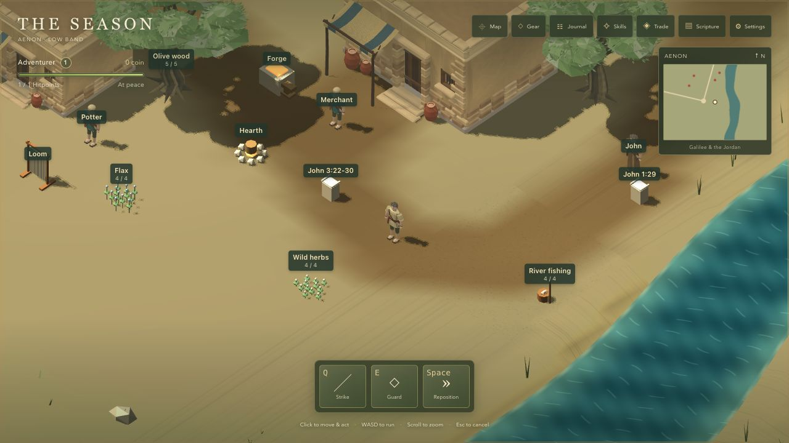
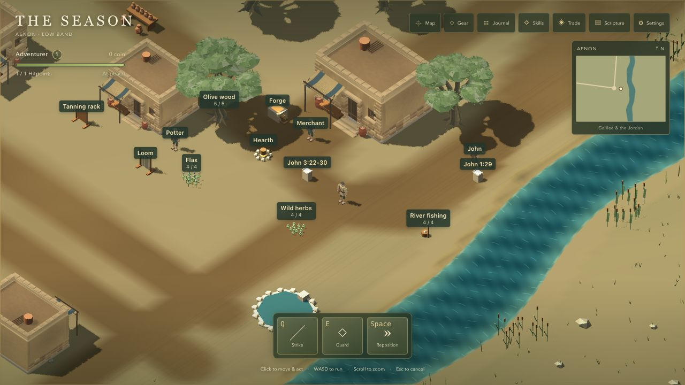
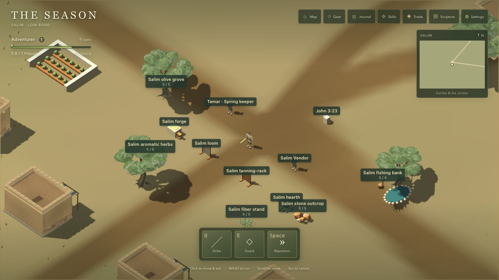
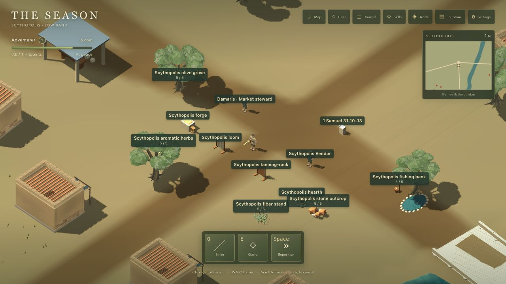
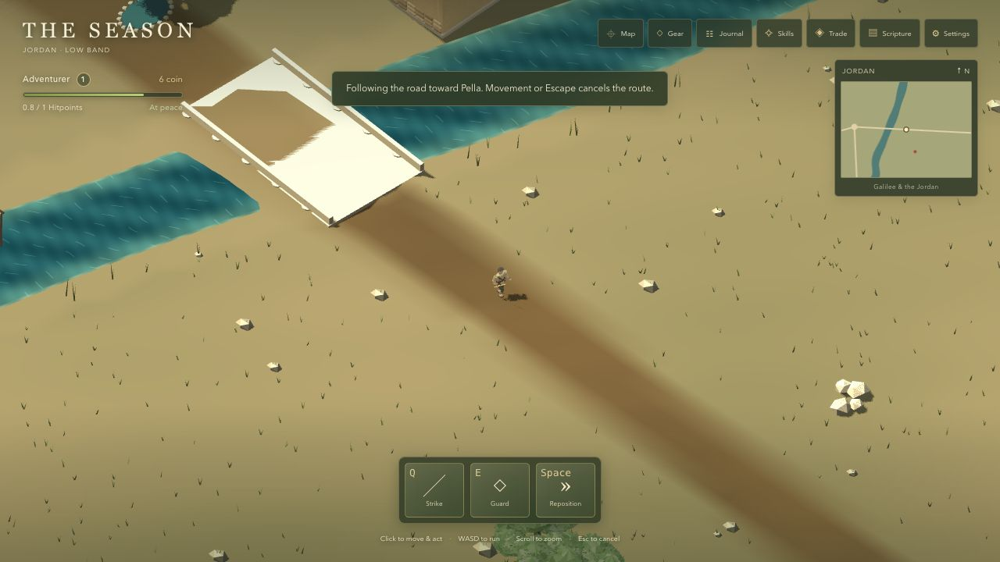
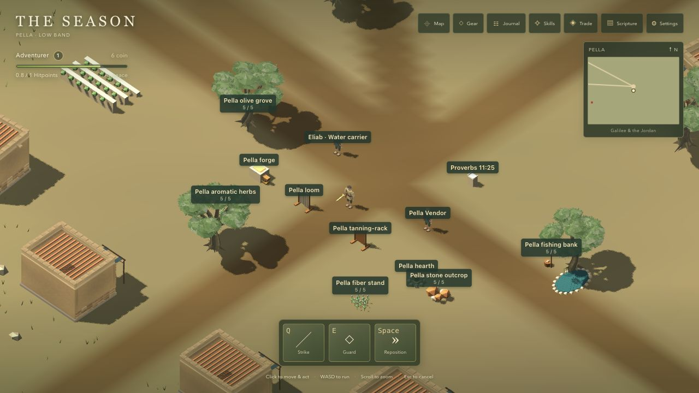

# Low-band scale review — issue #42

October 11, 2026. The low-band treatment expands Aenon, Salim, Scythopolis, Pella and the Jordan wilderness. The northern anchors, lake and five landings retain their coordinates. [ADR 0021](../adr/0021-low-band-distance-and-save-layout-revisions.md) records the decision; [follow-up #44](https://github.com/asvirts/aenon/issues/44) holds middle/high-band scaling until the low-band treatment is accepted.

## Coordinates and travel

| Place | Previous anchor (x, z) | Current anchor (x, z) | Previous → current radius |
| --- | --- | --- | --- |
| Aenon | −8, 4 | −8, 208 | 22 → 34 |
| Salim | −45, −8 | −206, 172 | 16 → 34 |
| Scythopolis | −5, −80 | −5, −80 | 18 → 38 |
| Pella | 70, −75 | 210, −65 | 17 → 36 |
| Jordan | 0, −35 | 0, 64 | 28 → 100 |

Bounds change from 435 × 461 to 550 × 686 units. The road graph retains its connections. Aenon–Salim runs west through low wilderness; Aenon–Scythopolis follows the western Jordan bank; Scythopolis–Pella crosses the Jordan causeway. Salim connects through Gilboa, while Pella continues to unchanged Gadara. The Aenon riverbank and original local objects translate together by +204 z, with starter enemies moved farther out into wilderness. The standalone first-area source remains intact.

These are actual pathfinder distances between the playable arrival points, divided by the unchanged base speed of **3.2 units/second**. They exclude pauses, encounters, gathering, combat and meal effects. Previous values were captured from the clean starting commit `74578d9`; after values include collision-aware detours around the expanded settlements.

| Walk | Previous distance | Previous time | Current distance | Current time |
| --- | ---: | ---: | ---: | ---: |
| Aenon → Salim | 44.8 | 14.0 s | 217.2 | 67.9 s |
| Aenon → Scythopolis | 79.2 | 24.8 s | 303.9 | 95.0 s |
| Aenon → Pella | 177.5 | 55.5 s | 519.4 | 162.3 s |
| Jordan crossing: Scythopolis → Pella | 75.9 | 23.7 s | 227.7 | 71.2 s |
| Salim → Scythopolis | — | — | 347.1 | 108.5 s |
| Pella → Gadara continuity check | — | — | 169.6 | 53.0 s |

Aenon–Salim needs more than the initial threefold guideline to become a minute-long walk; the other representative walks fall within roughly one to three minutes. The short starter gathering and work loop stays close to Aenon's center. This is playable geography, not a historical distance model.

## Settlement and wilderness treatment

Each low settlement has eight building footprints, using the existing original model with varied rotations and scales. Aenon has pottery yards and springs; Salim has enclosed gardens; Scythopolis has market shelters and columns; Pella has gardens and terrace details. Broad lanes separate houses and interactions. Rotated house footprints and offset scenery props participate in navigation collision.

The expanded low band has roadside rock clusters, milestones, camps, additional olive groups and reed banks. Dressing uses each candidate's actual band, so the low parts of Salim–Gilboa and Pella–Gadara are included without redesigning their northern destinations. The default orthographic half-width increases from 14 to 22, maximum from 24 to 32, and local-map radius from 32 to 48. The full map preserves geographical proportions and shows the Jordan.

Three Gilboa-edge hostile positions move only as required to keep them outside enlarged Scythopolis. Their identities, home places, tuning and quest targets remain intact. A full generated `SeasonDefinition` comparison against the baseline is equal: quest logic, enemy stats, rewards, experience, economy and catalog content are unchanged.

## Save continuity

Existing format-3 saves without a layout revision are revision 1. The new region exports layout revision 2. Loading or importing an old save validates it and verifies a byte-for-byte original backup before replacement. Affected Adventurers return to their last settlement's safe entry without a defeat penalty. Possessions, Hitpoints, experience, journals, quests, cooldowns and effects remain. Affected hostile, carcass and ground-loot positions move into the new geometry. Current-layout saves keep their location, and northern boat progress remains unchanged. Unsupported future layouts and failed backups block writing and retain the recovery path.

The old running instance still stops autosave/pagehide writes before a deliberate import or restart reload. This guard is essential independently of the layout migration.

## Review and validation

Separate code-review passes found an offset pottery jar outside its collision footprint and an undressed low-band portion of the Salim–Gilboa route. Both were corrected and independently cleared. Repository review guidance and a small memory note retain those lessons.

All browser work uses the Codex in-app browser at a separate QA origin, `http://127.0.0.1:5182/`, preserving the user's existing game origins.

### Automated results

`npm test`: **535 passed**, 39 suites, no failures or skips. `npm run typecheck`, `npm run build` and `git diff --check` pass. Coverage includes all world interaction approaches, every road and landing, complete quest progression, current and migrated save positions, original-backup failures, future-revision rejection, loot retention and unchanged northern boat progress. Long obstructed road searches are split into bounded local sections; sampled cold plans take tens of milliseconds, with a deterministic terrain-check budget regression.

Known build warning: the existing Babylon/glTF chunk remains larger than Vite's 500 kB warning threshold. The test runner also emits its existing experimental localStorage notice.

### Rendered evidence collected

- Walked through expanded Aenon, accepted the potter's work, gathered wood, returned it, earned and wore the bronze sword.
- Approached the moved riverbank Scripture object; John 1:29 loaded live with NIV identity and Biblica attribution.
- Followed the journal into the enlarged wilderness outskirts and defeated the starter wolf, retaining 0.76 Hitpoints and receiving its coin.
- Used Map → Set walking route from Aenon to Salim. Existing roadside acquaintances paused travel and were continued through the normal controls.
- Reloaded inside Salim at `(−205.99214257855473, 176.63017793851432)`; exact position and 9 coins remained. Opened the Vendor and bought rope for 3 coins.
- Reached Scythopolis through the expanded Salim–Gilboa approach, then crossed the Jordan causeway and walked to Pella with the map route. Continued to unchanged Gadara at `(82.00007576460914, −151.02099171485867)` with no terrain/navigation seam. Final reload retained that exact position, Gadara as last settlement, and 6 coins; saving remained enabled.
- Followed the Salim–Scythopolis route, paused in Settings partway along the road and read back both live and persisted position `(−126.0694452159481, 44.34028889775544)`. Reload retained that position and 6 coins exactly. As designed, movement orders cancel on reload; setting the route again continued the journey.

The checks above used ordinary UI actions. Read-only developer diagnostics verified position/save equality; no experience, coin, teleport or accelerated simulation was injected. Short observed frame rates on High at 1280 × 720 were roughly 95–110 FPS; these are incidental development-machine observations, not a sustained benchmark or a hardware guarantee.

| Original Aenon view | Expanded Aenon at the new default camera |
| --- | --- |
|  |  |

This is local implementation and browser evidence, not a production deployment or the reporter’s final visual acceptance. Issue #42 remains open for review and merge. No browser warnings or errors were observed in the final playable session.
