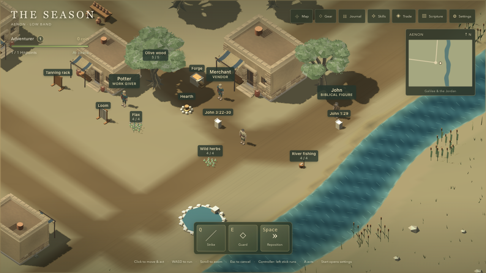
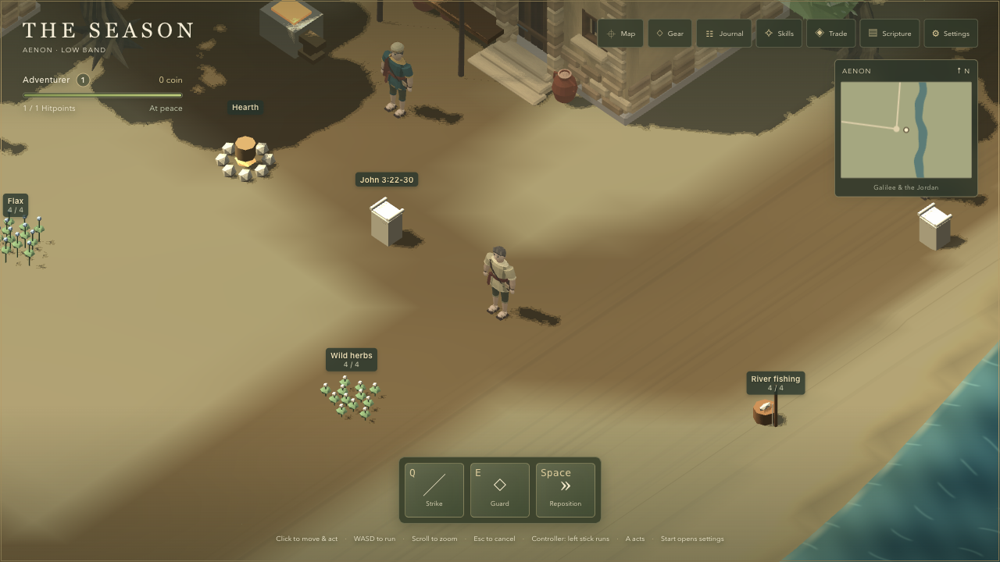
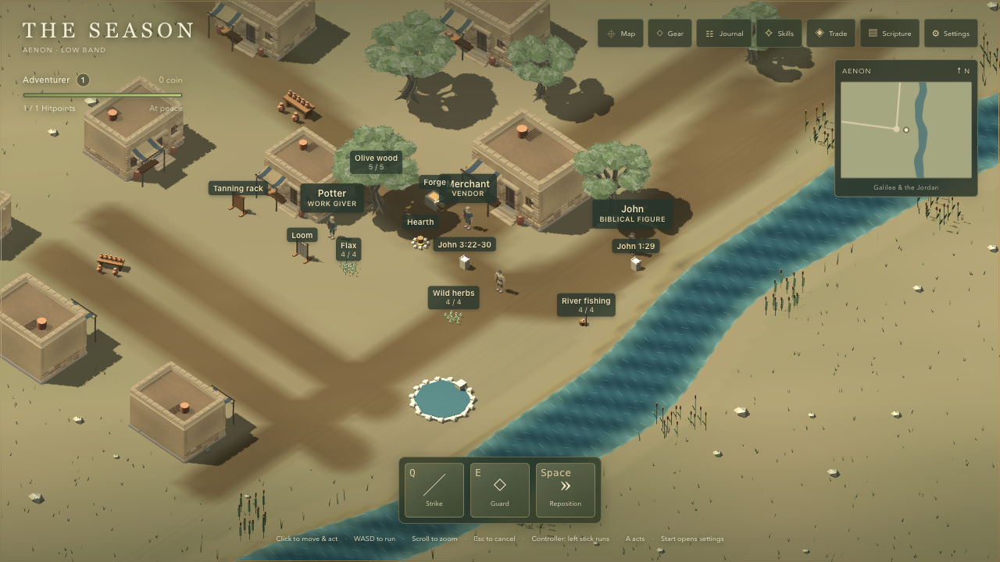
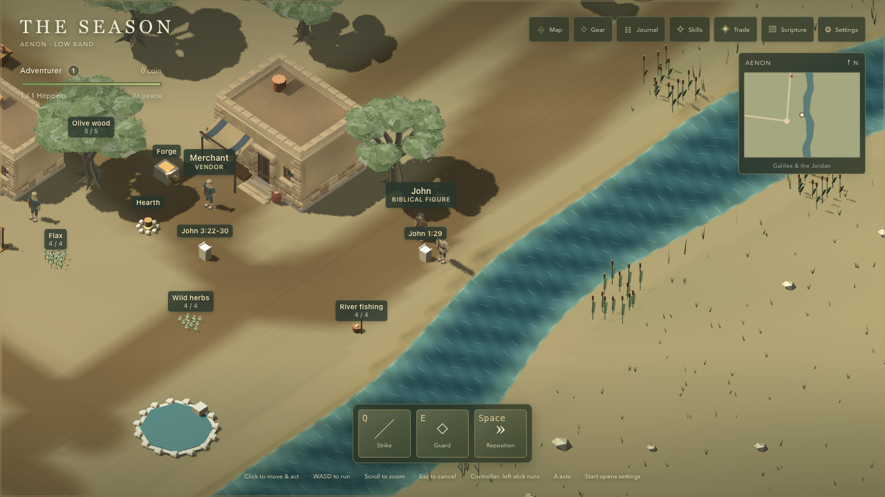
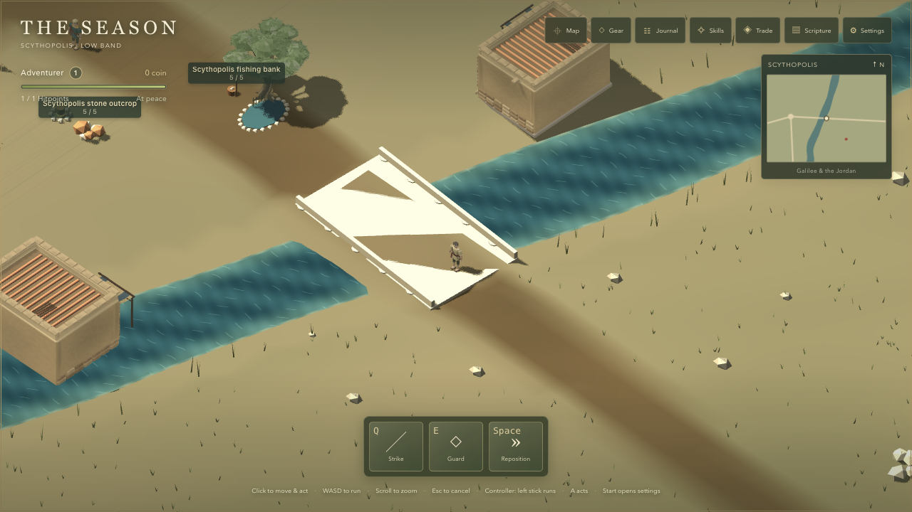
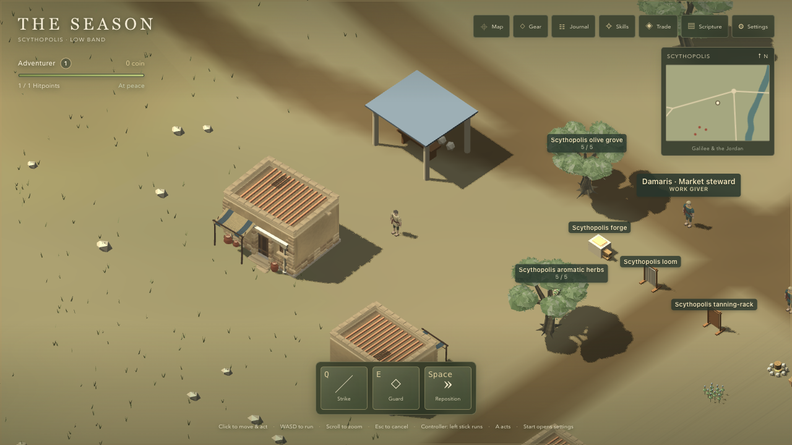
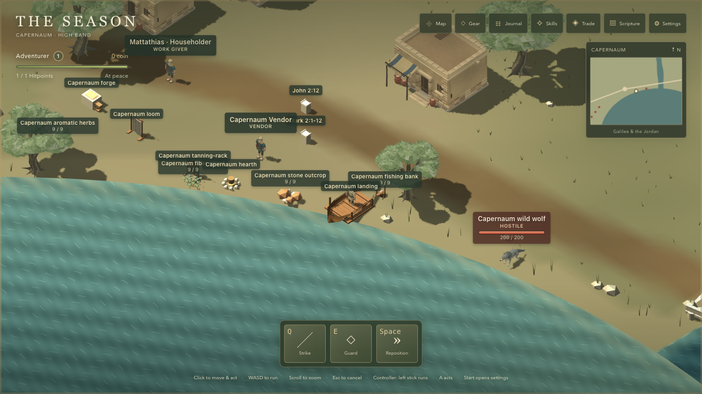
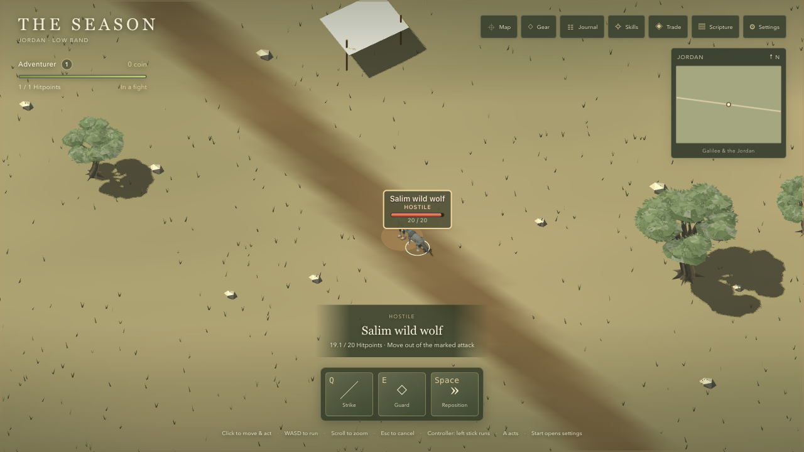

# Slice 1 — Review harness

Implements #50 under #41. **Reporter visual approval pending.**

Renderer/content base: `2778022a908ac3c7bd8608781c0fb07b42559f43`. Harness implementation: `c9f0a05c1a83de1cfb72937a2e7a33e9a8f1990f`. The baseline uses that development-only instrumentation on the unchanged base renderer. Slice 1 has no art change, so its before/after sets are two separate captures of this same renderer, not a claimed graphics improvement.

October 11, 2026. Apple MacBook Pro, M5 Pro (15 CPU / 16 GPU cores), 48 GB RAM; macOS 26.7.1; Codex in-app browser Chromium 155. CSS viewport 1280 × 720, device pixel ratio 1. Five seconds of visible warmup followed by ten seconds of completed frames per row. Review holds the simulation while skeletal animations continue. Development rendering timings; production transfer measured separately. These short samples do not establish sustained performance or the ordinary-laptop target.

## Verification

All 32 shots were repeated with identical returned fixture state. The largest repeated-frame difference was 43 pixels with any RGB channel differing by more than 8 / 255, out of 921,600 pixels. Normal skeletal animation phase is allowed to differ. See `repeatability.json`. Existing localStorage save and preference values remained byte-identical through all shots and preset changes; only the equality verdict is stored. Fight target `salim-threat-0` and John’s `Idle` animation were inspected after the independent-review fixes.

`npm test`: 564 passing; `npm run typecheck` and `npm run build` pass. Production-bundle test verifies no review hooks or module. Tests used Node 26.7.0; the package declares Node 24. Rules and save schema are unchanged.

## Performance

Baseline production load at `2778022`: **7.47 MB** (7,465,593 Resource Timing transferred bytes, including its standardized response-header allowance; 7,402,593 encoded body bytes). Cache disabled; 210 navigation/resource entries; game ready. Runtime download is identical for every preset; this single cold-load result is repeated in the rows. Raw entries are in [`../baseline/production-transfer.json`](../baseline/production-transfer.json).

| Preset | Shot / zoom | Viewport | Render size | Avg FPS | p95 ms | Draw calls | Active meshes | Triangles | First-load MB |
| --- | --- | --- | --- | ---: | ---: | ---: | ---: | ---: | ---: |
| Low | aenon-near / 10 | 1280 × 720 | 914 × 514 | 120.0 | 12.7 | 205 | 210 | 76710 | 7.47 |
| Low | aenon-far / 32 | 1280 × 720 | 914 × 514 | 117.0 | 12.6 | 762 | 778 | 214682 | 7.47 |
| Medium | aenon-near / 10 | 1280 × 720 | 1280 × 720 | 104.3 | 20.1 | 1055 | 218 | 253228 | 7.47 |
| Medium | aenon-far / 32 | 1280 × 720 | 1280 × 720 | 88.7 | 21.3 | 1625 | 799 | 399220 | 7.47 |
| High | aenon-near / 10 | 1280 × 720 | 1280 × 720 | 106.1 | 19.4 | 1055 | 218 | 253228 | 7.47 |
| High | aenon-far / 32 | 1280 × 720 | 1280 × 720 | 92.9 | 20.7 | 1625 | 799 | 399220 | 7.47 |
| Ultra | aenon-near / 10 | 1280 × 720 | 1280 × 720 | 104.3 | 19.8 | 1055 | 218 | 253228 | 7.47 |
| Ultra | aenon-far / 32 | 1280 × 720 | 1280 × 720 | 91.5 | 21.3 | 1625 | 799 | 399220 | 7.47 |

## High comparisons

| Shot | Before — High | After — High |
| --- | --- | --- |
| aenon-square |  |  |
| aenon-near |  |  |
| aenon-far |  |  |
| aenon-riverbank |  |  |
| jordan-bridge |  |  |
| scythopolis-market |  |  |
| sea-shore |  |  |
| fight |  |  |

## Every preset

Before:

| Shot | Low | Medium | High | Ultra |
| --- | --- | --- | --- | --- |
| aenon-square | [Low](before/aenon-square-low.png) | [Medium](before/aenon-square-medium.png) | [High](before/aenon-square-high.png) | [Ultra](before/aenon-square-ultra.png) |
| aenon-near | [Low](before/aenon-near-low.png) | [Medium](before/aenon-near-medium.png) | [High](before/aenon-near-high.png) | [Ultra](before/aenon-near-ultra.png) |
| aenon-far | [Low](before/aenon-far-low.png) | [Medium](before/aenon-far-medium.png) | [High](before/aenon-far-high.png) | [Ultra](before/aenon-far-ultra.png) |
| aenon-riverbank | [Low](before/aenon-riverbank-low.png) | [Medium](before/aenon-riverbank-medium.png) | [High](before/aenon-riverbank-high.png) | [Ultra](before/aenon-riverbank-ultra.png) |
| jordan-bridge | [Low](before/jordan-bridge-low.png) | [Medium](before/jordan-bridge-medium.png) | [High](before/jordan-bridge-high.png) | [Ultra](before/jordan-bridge-ultra.png) |
| scythopolis-market | [Low](before/scythopolis-market-low.png) | [Medium](before/scythopolis-market-medium.png) | [High](before/scythopolis-market-high.png) | [Ultra](before/scythopolis-market-ultra.png) |
| sea-shore | [Low](before/sea-shore-low.png) | [Medium](before/sea-shore-medium.png) | [High](before/sea-shore-high.png) | [Ultra](before/sea-shore-ultra.png) |
| fight | [Low](before/fight-low.png) | [Medium](before/fight-medium.png) | [High](before/fight-high.png) | [Ultra](before/fight-ultra.png) |

After:

| Shot | Low | Medium | High | Ultra |
| --- | --- | --- | --- | --- |
| aenon-square | [Low](after/aenon-square-low.png) | [Medium](after/aenon-square-medium.png) | [High](after/aenon-square-high.png) | [Ultra](after/aenon-square-ultra.png) |
| aenon-near | [Low](after/aenon-near-low.png) | [Medium](after/aenon-near-medium.png) | [High](after/aenon-near-high.png) | [Ultra](after/aenon-near-ultra.png) |
| aenon-far | [Low](after/aenon-far-low.png) | [Medium](after/aenon-far-medium.png) | [High](after/aenon-far-high.png) | [Ultra](after/aenon-far-ultra.png) |
| aenon-riverbank | [Low](after/aenon-riverbank-low.png) | [Medium](after/aenon-riverbank-medium.png) | [High](after/aenon-riverbank-high.png) | [Ultra](after/aenon-riverbank-ultra.png) |
| jordan-bridge | [Low](after/jordan-bridge-low.png) | [Medium](after/jordan-bridge-medium.png) | [High](after/jordan-bridge-high.png) | [Ultra](after/jordan-bridge-ultra.png) |
| scythopolis-market | [Low](after/scythopolis-market-low.png) | [Medium](after/scythopolis-market-medium.png) | [High](after/scythopolis-market-high.png) | [Ultra](after/scythopolis-market-ultra.png) |
| sea-shore | [Low](after/sea-shore-low.png) | [Medium](after/sea-shore-medium.png) | [High](after/sea-shore-high.png) | [Ultra](after/sea-shore-ultra.png) |
| fight | [Low](after/fight-low.png) | [Medium](after/fight-medium.png) | [High](after/fight-high.png) | [Ultra](after/fight-ultra.png) |
