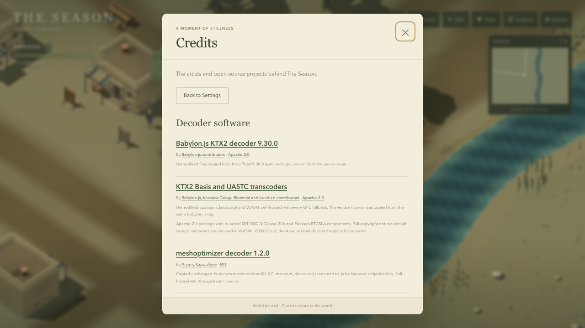
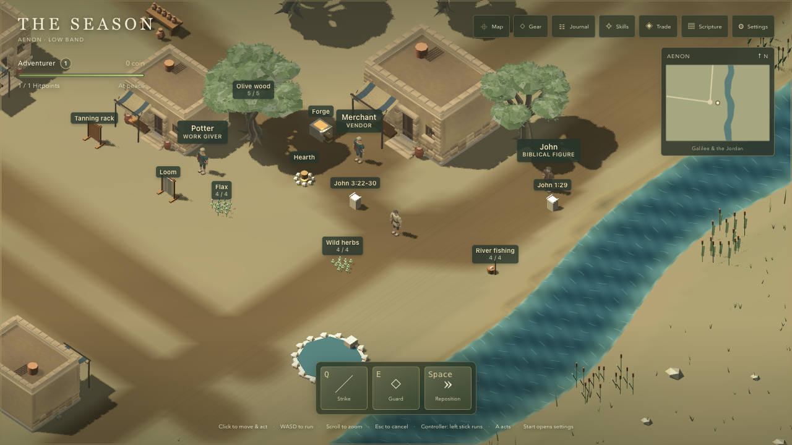
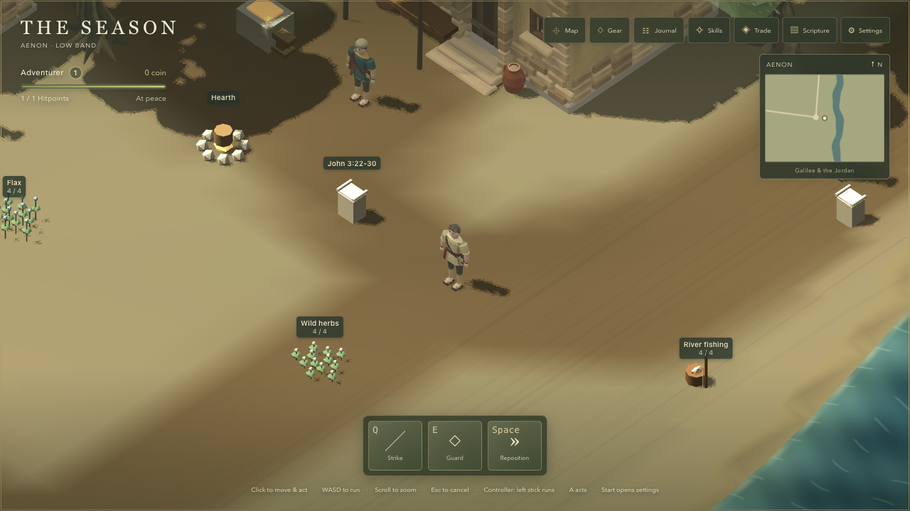
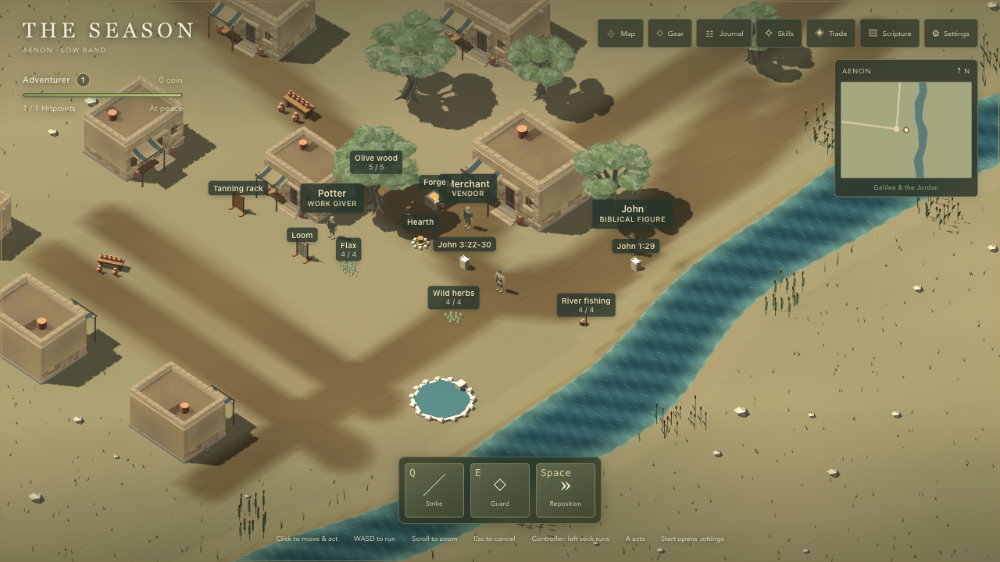
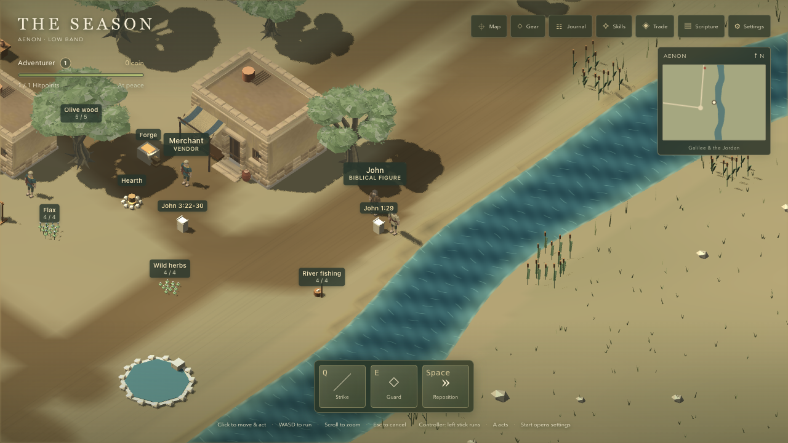
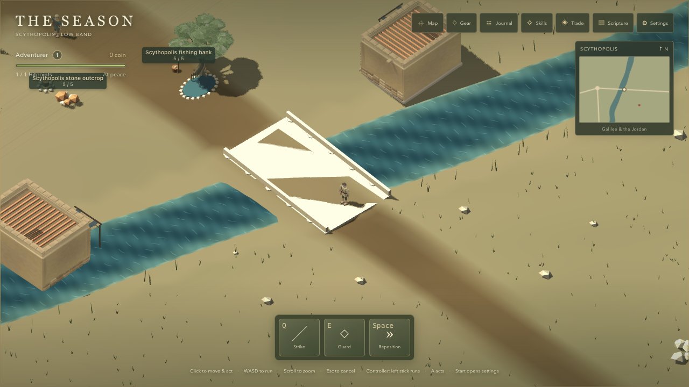
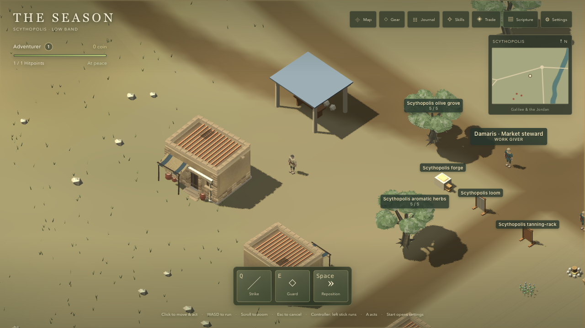
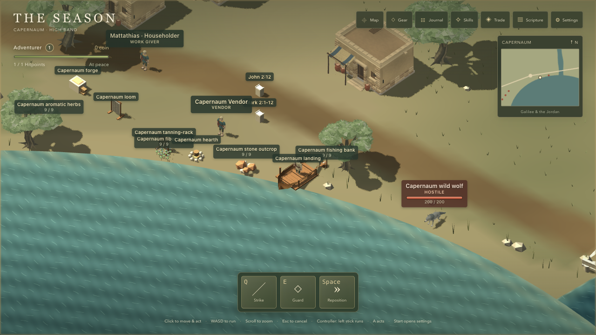
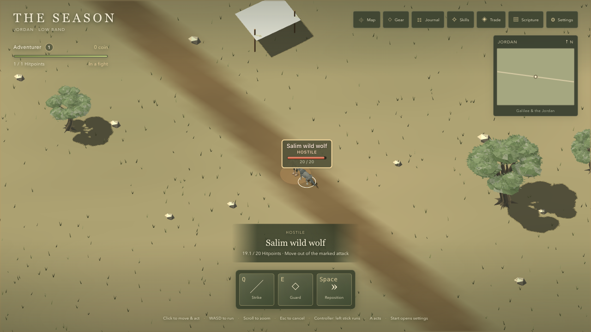

# Slice 2 — Asset intake

Implements #51 under #41. **Reporter visual approval pending.**

Base: `2778022a908ac3c7bd8608781c0fb07b42559f43`. Implementation head: `dc507f4` (includes compression commit `dd57023`). Before images and timing reuse the unchanged renderer baseline. For head capture only, the development harness from `c9f0a05` was applied as an uncommitted instrumentation overlay, retaining `configureAssetDecoders()` before boot; it was removed after capture. This PR remains independent of #50. The production load and Credits interaction checks ran without the overlay.

October 11, 2026. Apple MacBook Pro, M5 Pro (15 CPU / 16 GPU cores), 48 GB RAM; macOS 26.7.1; Codex in-app browser Chromium 155. CSS viewport 1280 × 720, device pixel ratio 1. Five seconds of visible warmup followed by ten seconds of completed frames per row. Review holds the simulation while skeletal animations continue. Development rendering timings; production transfer measured separately. These short samples do not establish sustained performance or the ordinary-laptop target.

## Result and verification

Every shipped public file has one manifest entry; repository and in-game credits share the manifest. The original house is now 284,496 bytes, down from 1,235,420 bytes (77% smaller), with meshopt geometry, ETC1S colour textures and a subtle original UASTC normal map. Its source remains committed.

All 564 tests pass, including credits coverage and binary KTX2/meshopt checks; typecheck/build pass. The real repository test failed when the new house/decoders were unregistered, then passed after manifest registration and credits generation: [red](credits-red.txt), [green](credits-green.txt). Credits opens from Settings by mouse and keyboard; its open time stayed fixed, and Escape/close returned to play. Simulated standard-controller Start → Down → A reached Credits; B closed it and resumed play. No physical-controller claim. Raw UI observations are in `ui-verification.json`. ADR 0023 and superseded ADR 0017 were already on the base. No rules or save changes. Node 26.7.0 used (package declares Node 24).

## Download

Production first playable load: base **7.47 MB**; head **7.06 MB estimated including headers**. Base uses browser Resource Timing. Head uses a transparent localhost request log to include KTX2 worker traffic absent from the main page timing list: 6,988,161 encoded payload bytes + 300 bytes × 228 responses. This 300-byte allowance matches Resource Timing, not a packet capture. Fresh origin; within-load worker cache revalidations are included. See the raw `production-transfer-*.json` and `production-requests.jsonl`. Meshopt, KTX2, Basis, Zstandard and ASTC decoder files were all served from the game origin (200 responses, followed by 304s for repeated worker imports). Main-page resource origins were local only; no game console errors. An unrelated favicon 404 is recorded. Other GPU transcoder fallbacks are present and tested by file/config coverage, not exercised on this GPU.

## Before performance

| Preset | Shot / zoom | Viewport | Render size | Avg FPS | p95 ms | Draw calls | Active meshes | Triangles | First-load MB |
| --- | --- | --- | --- | ---: | ---: | ---: | ---: | ---: | ---: |
| Low | aenon-near / 10 | 1280 × 720 | 914 × 514 | 120.0 | 12.7 | 205 | 210 | 76710 | 7.47 |
| Low | aenon-far / 32 | 1280 × 720 | 914 × 514 | 117.0 | 12.6 | 762 | 778 | 214682 | 7.47 |
| Medium | aenon-near / 10 | 1280 × 720 | 1280 × 720 | 104.3 | 20.1 | 1055 | 218 | 253228 | 7.47 |
| Medium | aenon-far / 32 | 1280 × 720 | 1280 × 720 | 88.7 | 21.3 | 1625 | 799 | 399220 | 7.47 |
| High | aenon-near / 10 | 1280 × 720 | 1280 × 720 | 106.1 | 19.4 | 1055 | 218 | 253228 | 7.47 |
| High | aenon-far / 32 | 1280 × 720 | 1280 × 720 | 92.9 | 20.7 | 1625 | 799 | 399220 | 7.47 |
| Ultra | aenon-near / 10 | 1280 × 720 | 1280 × 720 | 104.3 | 19.8 | 1055 | 218 | 253228 | 7.47 |
| Ultra | aenon-far / 32 | 1280 × 720 | 1280 × 720 | 91.5 | 21.3 | 1625 | 799 | 399220 | 7.47 |

## After performance

| Preset | Shot / zoom | Viewport | Render size | Avg FPS | p95 ms | Draw calls | Active meshes | Triangles | First-load MB |
| --- | --- | --- | --- | ---: | ---: | ---: | ---: | ---: | ---: |
| Low | aenon-near / 10 | 1280 × 720 | 914 × 514 | 120.0 | 12.5 | 205 | 210 | 76710 | 7.06 |
| Low | aenon-far / 32 | 1280 × 720 | 914 × 514 | 118.2 | 12.4 | 762 | 778 | 214682 | 7.06 |
| Medium | aenon-near / 10 | 1280 × 720 | 1280 × 720 | 108.7 | 19.9 | 1055 | 218 | 253228 | 7.06 |
| Medium | aenon-far / 32 | 1280 × 720 | 1280 × 720 | 92.3 | 21.7 | 1625 | 799 | 399220 | 7.06 |
| High | aenon-near / 10 | 1280 × 720 | 1280 × 720 | 103.6 | 20.6 | 1055 | 218 | 253228 | 7.06 |
| High | aenon-far / 32 | 1280 × 720 | 1280 × 720 | 92.9 | 21.6 | 1625 | 799 | 399220 | 7.06 |
| Ultra | aenon-near / 10 | 1280 × 720 | 1280 × 720 | 106.1 | 20.4 | 1055 | 218 | 253228 | 7.06 |
| Ultra | aenon-far / 32 | 1280 × 720 | 1280 × 720 | 89.0 | 22.4 | 1625 | 799 | 399220 | 7.06 |

Ten-second sample variation is not evidence of a performance improvement.

## High comparisons

| Shot | Before — High | After — High |
| --- | --- | --- |
| aenon-square |  |  |
| aenon-near |  |  |
| aenon-far |  |  |
| aenon-riverbank |  |  |
| jordan-bridge |  |  |
| scythopolis-market |  |  |
| sea-shore |  |  |
| fight |  |  |

## Every preset

Before:

| Shot | Low | Medium | High | Ultra |
| --- | --- | --- | --- | --- |
| aenon-square | [Low](before/aenon-square-low.png) | [Medium](before/aenon-square-medium.png) | [High](before/aenon-square-high.png) | [Ultra](before/aenon-square-ultra.png) |
| aenon-near | [Low](before/aenon-near-low.png) | [Medium](before/aenon-near-medium.png) | [High](before/aenon-near-high.png) | [Ultra](before/aenon-near-ultra.png) |
| aenon-far | [Low](before/aenon-far-low.png) | [Medium](before/aenon-far-medium.png) | [High](before/aenon-far-high.png) | [Ultra](before/aenon-far-ultra.png) |
| aenon-riverbank | [Low](before/aenon-riverbank-low.png) | [Medium](before/aenon-riverbank-medium.png) | [High](before/aenon-riverbank-high.png) | [Ultra](before/aenon-riverbank-ultra.png) |
| jordan-bridge | [Low](before/jordan-bridge-low.png) | [Medium](before/jordan-bridge-medium.png) | [High](before/jordan-bridge-high.png) | [Ultra](before/jordan-bridge-ultra.png) |
| scythopolis-market | [Low](before/scythopolis-market-low.png) | [Medium](before/scythopolis-market-medium.png) | [High](before/scythopolis-market-high.png) | [Ultra](before/scythopolis-market-ultra.png) |
| sea-shore | [Low](before/sea-shore-low.png) | [Medium](before/sea-shore-medium.png) | [High](before/sea-shore-high.png) | [Ultra](before/sea-shore-ultra.png) |
| fight | [Low](before/fight-low.png) | [Medium](before/fight-medium.png) | [High](before/fight-high.png) | [Ultra](before/fight-ultra.png) |

After:

| Shot | Low | Medium | High | Ultra |
| --- | --- | --- | --- | --- |
| aenon-square | [Low](after/aenon-square-low.png) | [Medium](after/aenon-square-medium.png) | [High](after/aenon-square-high.png) | [Ultra](after/aenon-square-ultra.png) |
| aenon-near | [Low](after/aenon-near-low.png) | [Medium](after/aenon-near-medium.png) | [High](after/aenon-near-high.png) | [Ultra](after/aenon-near-ultra.png) |
| aenon-far | [Low](after/aenon-far-low.png) | [Medium](after/aenon-far-medium.png) | [High](after/aenon-far-high.png) | [Ultra](after/aenon-far-ultra.png) |
| aenon-riverbank | [Low](after/aenon-riverbank-low.png) | [Medium](after/aenon-riverbank-medium.png) | [High](after/aenon-riverbank-high.png) | [Ultra](after/aenon-riverbank-ultra.png) |
| jordan-bridge | [Low](after/jordan-bridge-low.png) | [Medium](after/jordan-bridge-medium.png) | [High](after/jordan-bridge-high.png) | [Ultra](after/jordan-bridge-ultra.png) |
| scythopolis-market | [Low](after/scythopolis-market-low.png) | [Medium](after/scythopolis-market-medium.png) | [High](after/scythopolis-market-high.png) | [Ultra](after/scythopolis-market-ultra.png) |
| sea-shore | [Low](after/sea-shore-low.png) | [Medium](after/sea-shore-medium.png) | [High](after/sea-shore-high.png) | [Ultra](after/sea-shore-ultra.png) |
| fight | [Low](after/fight-low.png) | [Medium](after/fight-medium.png) | [High](after/fight-high.png) | [Ultra](after/fight-ultra.png) |
