# Slice 3 — Perspective camera

Implements [#52](https://github.com/asvirts/aenon/issues/52) under [#41](https://github.com/asvirts/aenon/issues/41). **Final-code evidence complete; reporter visual approval pending.**

Base: `751971842c24c3a68a2fe79c5ae96604b0b7c70c` (tree identical to merged asset-intake head `af13b91774cc30fd076852d199b92332e1e8d2c7`). Final implementation head: `8be0484c9f05e5e77f30444d33fc8ecffc09aee6`, including camera commit `efa457d` and the complete-house fade fix. All 32 after PNGs, nameplate records, timing samples, repeat captures and production measurements were refreshed for this final head. Both captures use the committed review harness. There are 32 before and 32 after PNGs, covering eight shots on Low, Medium, High and Ultra. Shot metadata lives in [before/shots.json](before/shots.json) and [after/shots.json](after/shots.json).

## Change

The root-route camera uses a 32° vertical perspective field of view, with radius 12 m / 22 m / 44 m at minimum / default / maximum zoom. Its viewing direction remains fixed at alpha π/4 and beta 0.83. Before values 10 / 22 / 32 are orthographic half-widths, so equal numbers do not mean equal framing. Occlusion rays now run from the camera to the Adventurer and selected target; visibility and shadow coverage expand with the perspective footprint. Occluding houses fade as complete groups, so their roof primitives cannot remain opaque.

## Protocol

October 11, 2026. Apple MacBook Pro, M5 Pro (15 CPU / 16 GPU cores), 48 GB RAM; macOS 26.7.1; Codex in-app Chromium 155. CSS viewport 1280 × 720, device pixel ratio 1. Follow the [review protocol](../../../review-protocol.md): five seconds of visible warmup, then ten seconds of completed frames per timing row. The harness holds simulation position and phase while skeletal animations continue. Timings are from development rendering; first playable production transfer is measured separately.

These short samples on one machine do not establish sustained performance, the ordinary-laptop target, or causality for any FPS difference. Capture and timing rows are evidence for review; they do not supply the reporter's visual verdict.

## Verification

The implementation agent reports **581 tests passed**, with `npm run typecheck` and `npm run build` passing on final code `8be0484c9f05e5e77f30444d33fc8ecffc09aee6`. No save-format change is part of this slice.

- **Ground corner clicks:** eight actual canvas clicks near all four corners, on High at radius 22 m and 44 m, ended within 0.04 m of the picked ground coordinates, unpaused and no longer moving. The maximum error was 0.03927 m; see [corner-walks.json](corner-walks.json). An initial region-introduction interruption was dismissed through the normal UI and excluded before repeating the checks.
- **Authored Spot corner selection:** all eight actual canvas clicks selected the intended Spot, walked into ordinary gathering range, and entered `gather` with the correct `targetId`; maximum arrival distance was 1.698 m, within 1.7 m. [spot-walks.json](spot-walks.json) records corner, radius, click, Spot ID, target and arrival. Normal-play test saves on a fresh QA origin set the starting position; the selections and walks used the actual game canvas.
- **Controls:** actual D-key movement, mouse-wheel radius change, and Settings minimum/default/maximum radius worked. Simulated gamepad movement and zoom retained fixed alpha π/4 and beta 0.83; see [controls.json](controls.json). A physical gamepad was not tested.
- **House fading:** the final fix fades the whole house group, including roof primitives and attached details. All 25 observed meshes reached visibility 0.23 behind the house and returned to 1 after clearing it; see [house-fade.json](house-fade.json), [faded](interaction/house-faded.png) and [cleared](interaction/house-cleared.png).
- **Nameplates and minimap:** final anchor records cover all 32 after captures, with 164 recorded label anchors inside the 1280 × 720 viewport; see [nameplate-anchors.json](nameplate-anchors.json). An actual minimap click opened the map; see [minimap-opened.png](interaction/minimap-opened.png).
- **Moving coverage:** at maximum radius 44 m, sampled movement on all four presets reported no on-screen missing terrain or world scenery (Low/Medium/High/Ultra: 19/14/15/16 samples); see [moving-coverage.json](moving-coverage.json). Worn-Gear exclusions are recorded separately. This is the sampled route, not a claim about every possible position.

Low measured **119.8–120.0 FPS** across the final-head ten-second zoom-extreme samples, above the 30 FPS threshold on this machine. The final eight-row table is below; one ten-second sample per row does not establish sustained performance or the ordinary-laptop target.

All 32 repeated final-head shot states matched; see [repeatability-after.json](repeatability-after.json). The PNG comparison counted pixels with a difference >8 in any RGB channel, without alignment or masks. The largest difference was **372 / 921,600 pixels (0.040365%)**, in `fight-low.png`. [repeat-image-differences-after.json](repeat-image-differences-after.json) retains all counts, bounding boxes and SHA-256 hashes. The harness continues skeletal animation; these differences alone do not establish their cause or the visual verdict.

**Reporter visual approval is the remaining acceptance gate.**

## Download

Fresh-origin production first-playable load, measured independently of development timings:

| Code | Encoded payload | Responses | Header allowance | Estimated transferred MB |
| --- | ---: | ---: | ---: | ---: |
| Before `7519718` | 6,988,223 bytes | 228 | 300 bytes/response | 7.056623 |
| After `8be0484` | 6,988,650 bytes | 228 | 300 bytes/response | 7.057050 |

A transparent localhost logging proxy includes decoder worker traffic and within-load cache revalidations. The 300-byte allowance follows Resource Timing; it is not a packet capture. Both loads round to 7.06 MB and remain below the 40 MB budget. The 427-byte estimated difference is not a meaningful download change.

See [before transfer](production-transfer-before.json), [after transfer](production-transfer-after.json), and the [before](production-requests-before.jsonl)/[after](production-requests-after.jsonl) request logs. Final production reached ready with no game console errors; review hooks were absent and main-page resources were local in [production-guard-after.json](production-guard-after.json). Recorded meshopt/KTX2/Basis/Zstandard/ASTC decoder responses came from the game origin. Other GPU-specific transcoder fallbacks were not exercised on this GPU.

## Before performance

Source: [performance-before.json](performance-before.json). The zoom column reports orthographic half-width.

| Preset | Shot / zoom | Viewport | Render size | Avg FPS | p95 ms | Draw calls | Active meshes | Triangles | First-load MB |
| --- | --- | --- | --- | ---: | ---: | ---: | ---: | ---: | ---: |
| Low | aenon-near / 10 | 1280 × 720 | 914 × 514 | 120.0 | 12.6 | 205 | 210 | 76710 | 7.06 |
| Low | aenon-far / 32 | 1280 × 720 | 914 × 514 | 110.0 | 13.0 | 762 | 778 | 214682 | 7.06 |
| Medium | aenon-near / 10 | 1280 × 720 | 1280 × 720 | 110.5 | 19.9 | 1055 | 218 | 253228 | 7.06 |
| Medium | aenon-far / 32 | 1280 × 720 | 1280 × 720 | 95.4 | 21.1 | 1625 | 799 | 399220 | 7.06 |
| High | aenon-near / 10 | 1280 × 720 | 1280 × 720 | 107.8 | 20.0 | 1055 | 218 | 253228 | 7.06 |
| High | aenon-far / 32 | 1280 × 720 | 1280 × 720 | 95.9 | 21.1 | 1625 | 799 | 399220 | 7.06 |
| Ultra | aenon-near / 10 | 1280 × 720 | 1280 × 720 | 95.8 | 22.3 | 1055 | 218 | 253228 | 7.06 |
| Ultra | aenon-far / 32 | 1280 × 720 | 1280 × 720 | 72.0 | 27.0 | 1625 | 799 | 399220 | 7.06 |

## After performance

Final head: `8be0484c9f05e5e77f30444d33fc8ecffc09aee6`. Source: [performance-after.json](performance-after.json). Zoom is perspective radius. First-load MB comes from the separate production measurement above.

| Preset | Shot / zoom | Viewport | Render size | Avg FPS | p95 ms | Draw calls | Active meshes | Triangles | First-load MB |
| --- | --- | --- | --- | ---: | ---: | ---: | ---: | ---: | ---: |
| Low | aenon-near / 12 m | 1280 × 720 | 914 × 514 | 119.8 | 9.8 | 144 | 148 | 76212 | 7.06 |
| Low | aenon-far / 44 m | 1280 × 720 | 914 × 514 | 120.0 | 9.9 | 575 | 589 | 200682 | 7.06 |
| Medium | aenon-near / 12 m | 1280 × 720 | 1280 × 720 | 107.4 | 18.8 | 997 | 159 | 255388 | 7.06 |
| Medium | aenon-far / 44 m | 1280 × 720 | 1280 × 720 | 92.3 | 19.8 | 1585 | 612 | 447052 | 7.06 |
| High | aenon-near / 12 m | 1280 × 720 | 1280 × 720 | 107.4 | 18.9 | 997 | 159 | 255388 | 7.06 |
| High | aenon-far / 44 m | 1280 × 720 | 1280 × 720 | 88.5 | 20.7 | 1585 | 612 | 447052 | 7.06 |
| Ultra | aenon-near / 12 m | 1280 × 720 | 1280 × 720 | 104.8 | 19.0 | 997 | 159 | 255388 | 7.06 |
| Ultra | aenon-far / 44 m | 1280 × 720 | 1280 × 720 | 90.4 | 20.5 | 1585 | 612 | 447052 | 7.06 |

## High comparisons

Before: `7519718`. After: `8be0484`. These are the judging-preset frames; visual approval is pending.

| Shot | Before — High | After — High |
| --- | --- | --- |
| aenon-square | 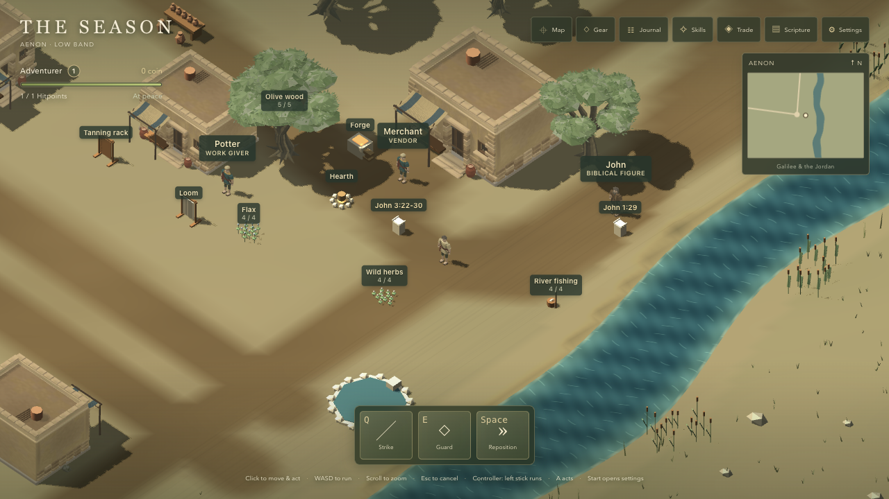 | 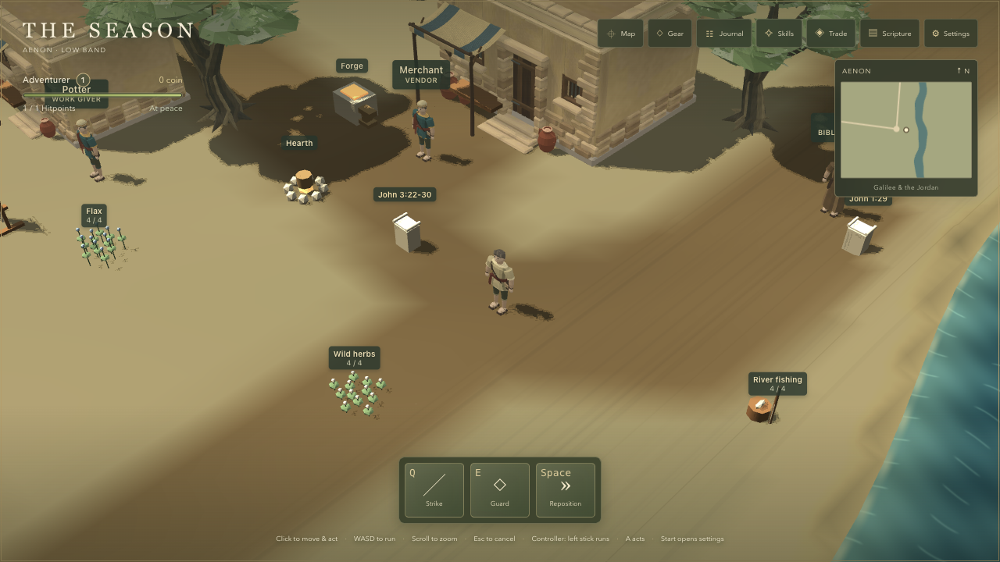 |
| aenon-near | 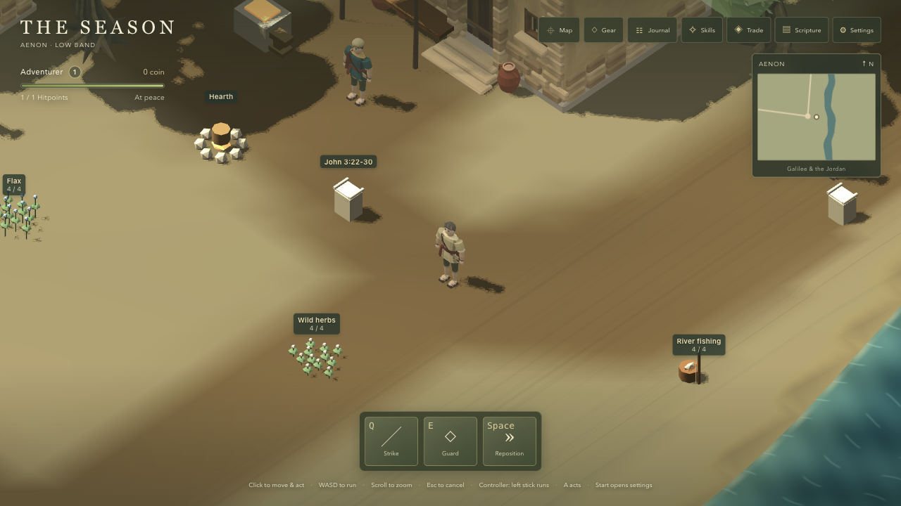 | 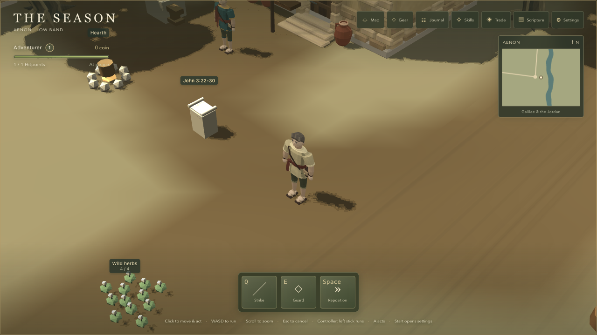 |
| aenon-far | 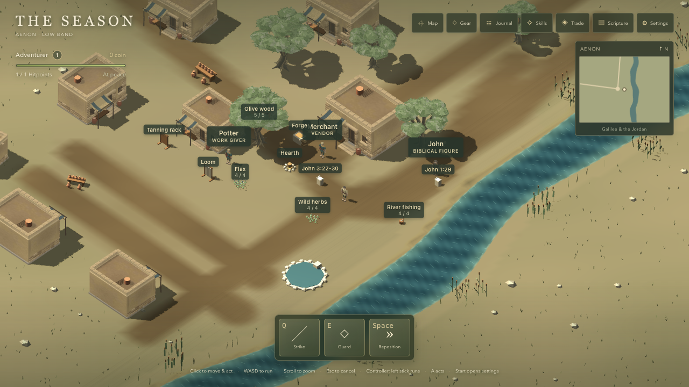 | 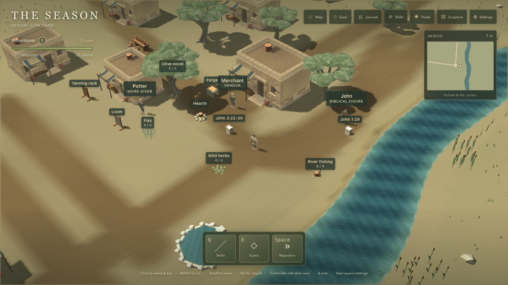 |
| aenon-riverbank | 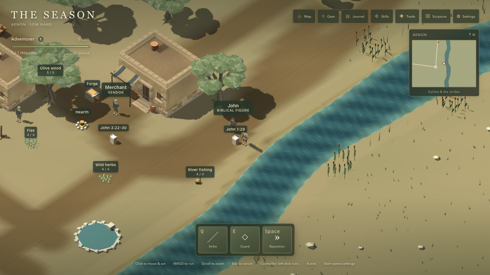 | 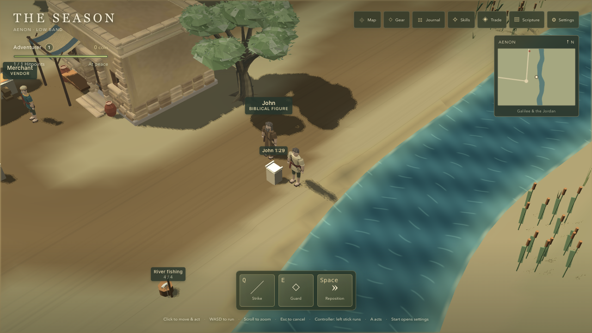 |
| jordan-bridge | 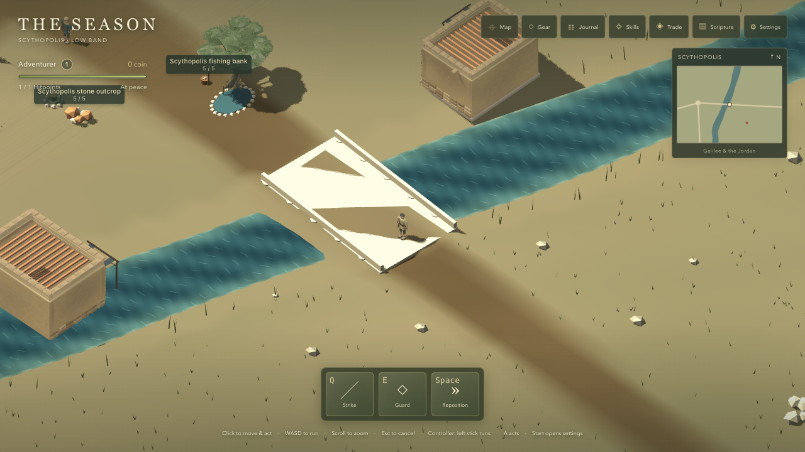 | 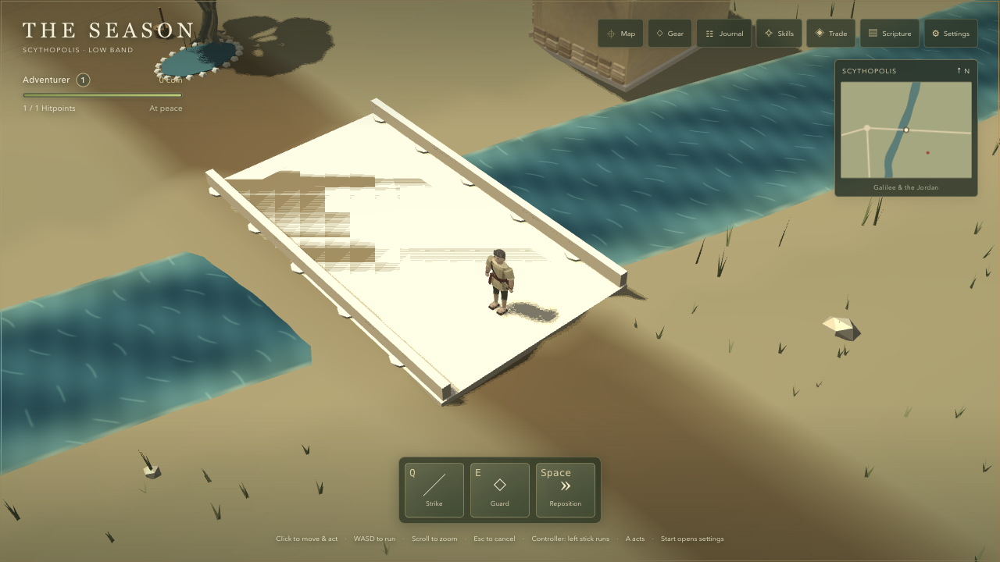 |
| scythopolis-market | 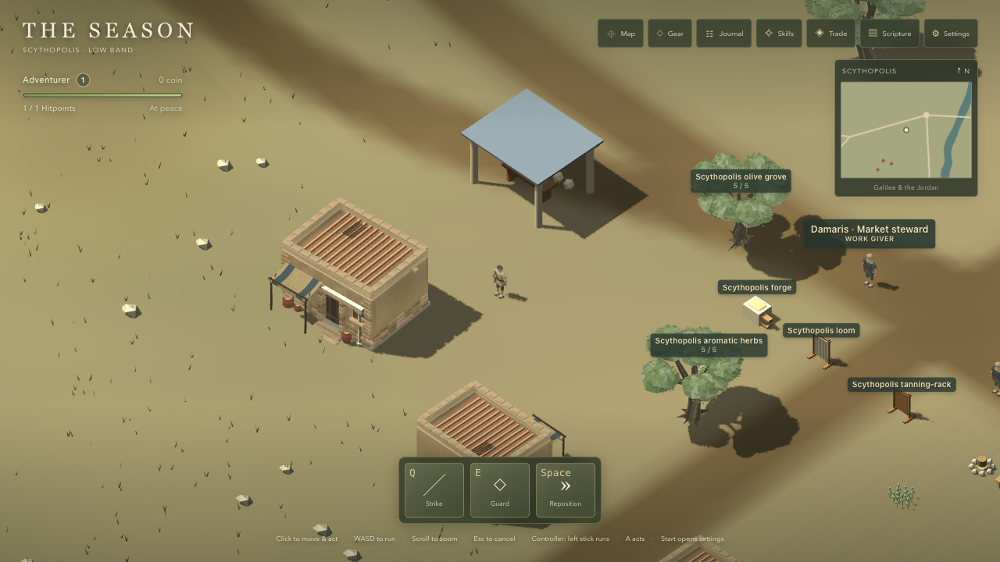 | 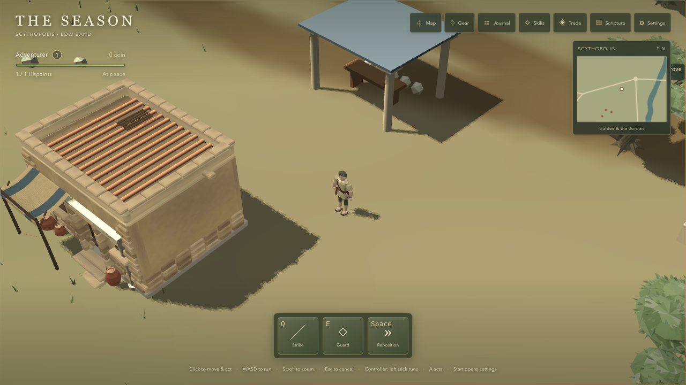 |
| sea-shore | 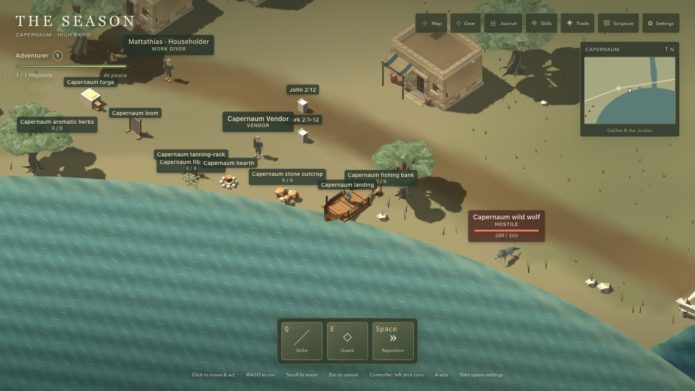 | 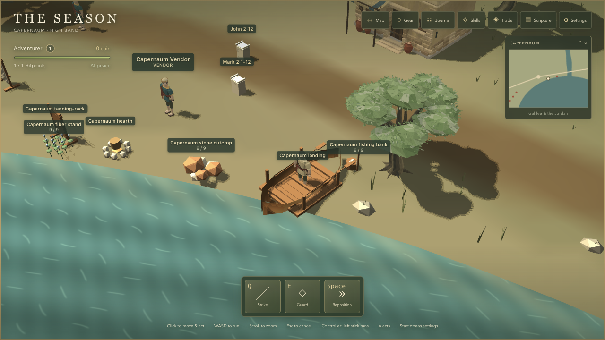 |
| fight | 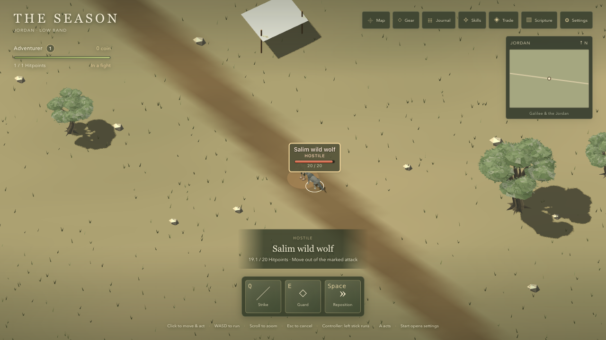 | 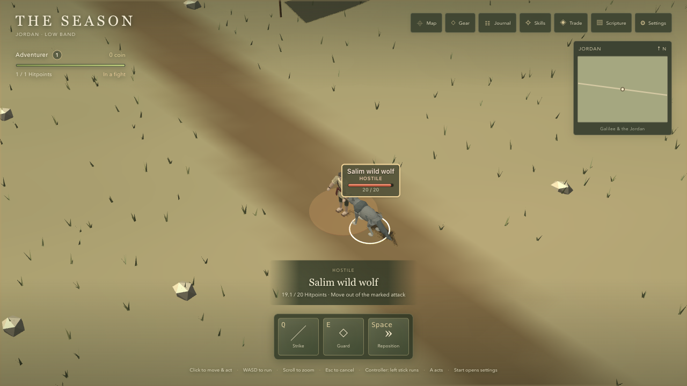 |

## Every preset

Before:

| Shot | Low | Medium | High | Ultra |
| --- | --- | --- | --- | --- |
| aenon-square | [Low](before/aenon-square-low.png) | [Medium](before/aenon-square-medium.png) | [High](before/aenon-square-high.png) | [Ultra](before/aenon-square-ultra.png) |
| aenon-near | [Low](before/aenon-near-low.png) | [Medium](before/aenon-near-medium.png) | [High](before/aenon-near-high.png) | [Ultra](before/aenon-near-ultra.png) |
| aenon-far | [Low](before/aenon-far-low.png) | [Medium](before/aenon-far-medium.png) | [High](before/aenon-far-high.png) | [Ultra](before/aenon-far-ultra.png) |
| aenon-riverbank | [Low](before/aenon-riverbank-low.png) | [Medium](before/aenon-riverbank-medium.png) | [High](before/aenon-riverbank-high.png) | [Ultra](before/aenon-riverbank-ultra.png) |
| jordan-bridge | [Low](before/jordan-bridge-low.png) | [Medium](before/jordan-bridge-medium.png) | [High](before/jordan-bridge-high.png) | [Ultra](before/jordan-bridge-ultra.png) |
| scythopolis-market | [Low](before/scythopolis-market-low.png) | [Medium](before/scythopolis-market-medium.png) | [High](before/scythopolis-market-high.png) | [Ultra](before/scythopolis-market-ultra.png) |
| sea-shore | [Low](before/sea-shore-low.png) | [Medium](before/sea-shore-medium.png) | [High](before/sea-shore-high.png) | [Ultra](before/sea-shore-ultra.png) |
| fight | [Low](before/fight-low.png) | [Medium](before/fight-medium.png) | [High](before/fight-high.png) | [Ultra](before/fight-ultra.png) |

After:

| Shot | Low | Medium | High | Ultra |
| --- | --- | --- | --- | --- |
| aenon-square | [Low](after/aenon-square-low.png) | [Medium](after/aenon-square-medium.png) | [High](after/aenon-square-high.png) | [Ultra](after/aenon-square-ultra.png) |
| aenon-near | [Low](after/aenon-near-low.png) | [Medium](after/aenon-near-medium.png) | [High](after/aenon-near-high.png) | [Ultra](after/aenon-near-ultra.png) |
| aenon-far | [Low](after/aenon-far-low.png) | [Medium](after/aenon-far-medium.png) | [High](after/aenon-far-high.png) | [Ultra](after/aenon-far-ultra.png) |
| aenon-riverbank | [Low](after/aenon-riverbank-low.png) | [Medium](after/aenon-riverbank-medium.png) | [High](after/aenon-riverbank-high.png) | [Ultra](after/aenon-riverbank-ultra.png) |
| jordan-bridge | [Low](after/jordan-bridge-low.png) | [Medium](after/jordan-bridge-medium.png) | [High](after/jordan-bridge-high.png) | [Ultra](after/jordan-bridge-ultra.png) |
| scythopolis-market | [Low](after/scythopolis-market-low.png) | [Medium](after/scythopolis-market-medium.png) | [High](after/scythopolis-market-high.png) | [Ultra](after/scythopolis-market-ultra.png) |
| sea-shore | [Low](after/sea-shore-low.png) | [Medium](after/sea-shore-medium.png) | [High](after/sea-shore-high.png) | [Ultra](after/sea-shore-ultra.png) |
| fight | [Low](after/fight-low.png) | [Medium](after/fight-medium.png) | [High](after/fight-high.png) | [Ultra](after/fight-ultra.png) |

