# Slice 4 — Lighting and atmosphere

Implements [#53](https://github.com/asvirts/aenon/issues/53) under [#41](https://github.com/asvirts/aenon/issues/41). **Final-code evidence complete; reporter visual approval pending.**

Base: `9887b9425a10a68aee5f8f2529e18b2313484f6c`. The 32 before PNGs and eight before timing rows were captured for this slice. Final implementation head: `c38295d724e971bda802cb3bf3b6e4af95c13198`, including `5259262` (quality recommendation), `adfe2c3` (lighting), `f6e20c8` (HDRI intake) and the cue-colour fix. All 32 after PNGs, [frame-checks.json](frame-checks.json), timing rows, repeat captures and production measurements come from that head. Exposure is 1.35 and contrast 1.15. Shot metadata is in [before/shots.json](before/shots.json) and [after/shots.json](after/shots.json).

## Change

```diff
- Flat ambient light, Poisson shadows and mostly StandardMaterial scenery
+ CC0 prefiltered sky environment, PBR scenery, warm sunlight and cooler fill
+ ACES tone mapping and warm haze, including the custom water shader
+ Medium: PCF shadows and FXAA
+ High: contact-hardening shadows, 4× MSAA, half-size SSAO and subtle bloom
+ Ultra: four shadow cascades, 4× MSAA, full-size SSAO and subtle bloom
+ Settings descriptions and conservative first-visit quality recommendation
```

The fixed perspective camera retains radius 12 m / 22 m / 44 m at minimum / default / maximum zoom. Low retains reduced resolution and omits shadows and post-processing. Medium, High and Ultra are intended to differ visibly at DPR 1; the final side-by-side captures and reporter's verdict must establish that acceptance criterion. Manual `aenon-graphics-quality` selections take precedence over hardware hints. This slice does not change the simulation or save format.

## Protocol

October 11, 2026. Apple MacBook Pro, M5 Pro (15 CPU / 16 GPU cores), 48 GB RAM; macOS 26.7.1; Codex in-app Chromium 155. CSS viewport 1280 × 720, DPR 1. Five seconds of visible warmup and ten seconds of completed frames per timing row. Timing measures development rendering; an uncached production first-playable download is recorded separately. Each row is one short sample on one machine, so these measurements do not establish sustained performance, the ordinary-laptop target, or causality for an FPS difference. Follow the [review protocol](../../../review-protocol.md). The harness holds simulation position and phase while skeletal animation continues; state repeatability and pixel differences are reported separately below.

## Verification

The implementation reports **590 tests passed**, with typecheck and production build passing on final code `c38295d724e971bda802cb3bf3b6e4af95c13198`. Asset intake independently passed all six credits tests after the real unregistered-file test failed as expected; the converter passed a standalone strict TypeScript check.

- **Frame records:** all 32 captures report the environment ready. The 164 recorded label anchors are within the 1280 × 720 viewport, with the same per-shot label counts across presets. Anchor bounds do not establish that HUD elements never overlap labels.
- **Combat cues:** all four fight frames record the selected-target ring and attack-warning disc as enabled, unlit and at visibility 1. The ring has alpha 1; the sampled warning phase has alpha 0.219. The Adventurer, wolf, ring, orange warning disc and hostile label remain discernible in the four inspected fight PNGs. This evidence covers that captured fight and warning phase.
- **Preset settings:** [settings-qa.json](settings-qa.json) records native keyboard selection, a High → Low → Ultra → High sequence, saved overrides and High persistence after reload. Returning to Low removes the shadow map, AO, bloom and prepass MSAA. The fresh M5 Pro recommendation was Medium. An initial automation timeout during Ultra shader compilation was excluded and repeated using native input.
- **Production house smoke:** normal Settings import placed the Adventurer at (−33.03, 198.98), High, radius 22 m. The house faded and the Adventurer remained discernible; native A held for 1.8 seconds moved to (−37.0981833, 203.0481833), after which the house appeared fully restored with no obvious AO halo. See [faded](interaction/house-faded-high.png), [cleared](interaction/house-cleared-high.png) and [interaction-qa.json](interaction-qa.json). This one-house qualitative check used a 1280 × 720 CSS viewport but a **1920 × 1080 render size** (native DPR 2, capped to 1.5 on High); it is separate from all canonical screenshots, repeat comparisons and timing rows at DPR 1.
- **Production Credits:** the normal Settings Credits UI visibly displayed Qwantani (Pure Sky), Greg Zaal, Jarod Guest and CC0-1.0; recorded in [interaction-qa.json](interaction-qa.json).
- **Pipeline readback:** High records a 640 × 360 AO output with 16 samples; Ultra records 1280 × 720 with 32 samples and four shadow cascades. Both use four-sample MSAA. Medium/High shadow detail differs visibly in the Aenon square comparisons; High/Ultra differences are subtler. Pipeline readback does not replace the reporter's judgment of distinctness at DPR 1.

Retained visual limitations: the Aenon square's John label is partly covered by the minimap and the Potter label overlaps the HUD in both before and after captures. The Jordan bridge retains deck striping/geometry seams already visible more strongly in the baseline; architecture slice [#58](https://github.com/asvirts/aenon/issues/58) owns that geometry. This slice does not claim those defects are fixed or introduce them as lighting regressions.

Low averaged **114.9–120.0 FPS**, above 30 FPS, and High averaged **70.3–91.6 FPS**, above the 60 FPS aim, in these final-head samples. Medium averaged 90.8–107.6 FPS and Ultra 65.8–78.7 FPS. Each range covers two ten-second samples on this M5 Pro, not sustained play or the ordinary-laptop target. High and Ultra have lower sampled averages than the baseline; the tables report the observed cost without establishing a causal benchmark.

All 32 repeated final-head shot states matched; see [repeatability-after.json](repeatability-after.json). Pixel comparison counts a pixel when any RGB channel differs by more than 8/255, without alignment or masks. The largest difference was **1,025 / 921,600 pixels (0.111220%)**, in `fight-high.png`, within bounding box `[609, 321, 744, 465]`. [repeat-image-differences-after.json](repeat-image-differences-after.json) retains all counts, bounding boxes and SHA-256 hashes. Continuing skeletal animation can vary between frames; these statistics alone do not establish the cause or the reporter's visual verdict.

**Reporter visual approval remains the acceptance gate**, including Medium/High/Ultra distinctness at DPR 1 and the retained visual limitations above. QA covers the recorded review states, native preset transitions, the production house/credits smoke checks and production load; it does not establish behavior at every world position or on other GPUs.

## HDRI provenance

[Qwantani (Pure Sky)](https://polyhaven.com/a/qwantani_puresky), original photography by Greg Zaal and sky edits by Jarod Guest, is declared CC0 by the official asset and [licence pages](https://polyhaven.com/license). The retained source is the official 1K HDR (1,142,401 bytes). The shipped file is **567,390 bytes**: a 256px cubemap, nine specular mip levels, 54 PNG RGBD images and diffuse spherical polynomial data. All embedded PNG dimensions, RGBA encoding and decompressed lengths were checked; all 27 diffuse coefficients are finite. No exposure, tint or rotation is baked in.

The raw source, checksums, complete CC0 text and reproducible conversion instructions are retained under [art/vendor/polyhaven/qwantani-puresky](../../../../../art/vendor/polyhaven/qwantani-puresky/). [environment-conversion.json](environment-conversion.json) records the successful isolated in-app GPU conversion. Only the `.env` file ships; [art/credits.json](../../../../../art/credits.json) and generated [CREDITS.md](../../../../../CREDITS.md) register it. The 1 MB individual-asset budget and the 40 MB first-playable budget both pass in the measurements below.

## Download

| Code | Encoded payload | Responses | Header allowance | Estimated transferred MB |
| --- | ---: | ---: | ---: | ---: |
| Before `9887b94` (runtime-equivalent `8be0484` bundle) | 6,988,650 bytes | 228 | 300 bytes/response | 7.057050 |
| After `c38295d` | 7,554,960 bytes | 230 | 300 bytes/response | 7.623960 |

The baseline uses the production bundle from `8be0484c9f05e5e77f30444d33fc8ecffc09aee6`: `src/`, `public/`, `package.json` and `package-lock.json` match the merged base; the base additionally contains reviewed evidence and skill guidance. This is recorded in [production-transfer-before.json](production-transfer-before.json). A fresh-origin transparent localhost logging proxy includes decoder worker requests; the 300-byte response allowance is an estimate, not a packet capture. See [baseline request log](production-requests-before.jsonl) and [baseline production guard](production-guard-before.json). Final evidence is in [production-transfer-after.json](production-transfer-after.json), [production-requests-after.jsonl](production-requests-after.jsonl) and [production-guard-after.json](production-guard-after.json). The increase is 566,910 estimated bytes; the final 7.62 MB load remains below 40 MB. The environment returned HTTP 200 with 563,276 gzip-encoded bytes. Production reached ready, selected Medium for the M5 Pro, loaded the environment, exposed no review hooks and reported only game-origin main-page resources; recorded decoder traffic was also same-origin. The browser run reported no warning/error console entries. Other GPUs and their decoder fallbacks were not exercised.

## Before performance

Source: [performance-before.json](performance-before.json). Perspective radius is shown in the zoom column. First-load MB comes from the separate production measurement above.

| Preset | Shot / radius | Viewport | Render size | Avg FPS | p95 ms | Draw calls | Active meshes | Triangles | First-load MB |
| --- | --- | --- | --- | ---: | ---: | ---: | ---: | ---: | ---: |
| Low | aenon-near / 12 m | 1280 × 720 | 914 × 514 | 120.0 | 9.5 | 144 | 148 | 76212 | 7.06 |
| Low | aenon-far / 44 m | 1280 × 720 | 914 × 514 | 117.1 | 10.0 | 575 | 589 | 200682 | 7.06 |
| Medium | aenon-near / 12 m | 1280 × 720 | 1280 × 720 | 110.4 | 17.9 | 997 | 159 | 255388 | 7.06 |
| Medium | aenon-far / 44 m | 1280 × 720 | 1280 × 720 | 96.1 | 19.1 | 1585 | 612 | 447052 | 7.06 |
| High | aenon-near / 12 m | 1280 × 720 | 1280 × 720 | 110.3 | 18.0 | 997 | 159 | 255388 | 7.06 |
| High | aenon-far / 44 m | 1280 × 720 | 1280 × 720 | 101.2 | 18.5 | 1585 | 612 | 447052 | 7.06 |
| Ultra | aenon-near / 12 m | 1280 × 720 | 1280 × 720 | 110.5 | 18.0 | 997 | 159 | 255388 | 7.06 |
| Ultra | aenon-far / 44 m | 1280 × 720 | 1280 × 720 | 100.4 | 18.5 | 1585 | 612 | 447052 | 7.06 |

## After performance

Final head: `c38295d724e971bda802cb3bf3b6e4af95c13198`. Source: [performance-after.json](performance-after.json). First-load MB comes from the separate production measurement above.

| Preset | Shot / radius | Viewport | Render size | Avg FPS | p95 ms | Draw calls | Active meshes | Triangles | First-load MB |
| --- | --- | --- | --- | ---: | ---: | ---: | ---: | ---: | ---: |
| Low | aenon-near / 12 m | 1280 × 720 | 914 × 514 | 120.0 | 9.6 | 144 | 148 | 76212 | 7.62 |
| Low | aenon-far / 44 m | 1280 × 720 | 914 × 514 | 114.9 | 11.2 | 575 | 589 | 200682 | 7.62 |
| Medium | aenon-near / 12 m | 1280 × 720 | 1280 × 720 | 107.6 | 17.8 | 999 | 159 | 255388 | 7.62 |
| Medium | aenon-far / 44 m | 1280 × 720 | 1280 × 720 | 90.8 | 19.3 | 1587 | 612 | 447052 | 7.62 |
| High | aenon-near / 12 m | 1280 × 720 | 1280 × 720 | 91.6 | 19.4 | 1007 | 159 | 255388 | 7.62 |
| High | aenon-far / 44 m | 1280 × 720 | 1280 × 720 | 70.3 | 24.9 | 1595 | 612 | 447052 | 7.62 |
| Ultra | aenon-near / 12 m | 1280 × 720 | 1280 × 720 | 78.7 | 21.1 | 3533 | 159 | 776614 | 7.62 |
| Ultra | aenon-far / 44 m | 1280 × 720 | 1280 × 720 | 65.8 | 23.6 | 4556 | 612 | 1152880 | 7.62 |


## High comparisons

Before: `9887b94`. After: `c38295d`. High is the judging preset; reporter visual approval is pending.

| Shot | Before — High | After — High |
| --- | --- | --- |
| aenon-square | 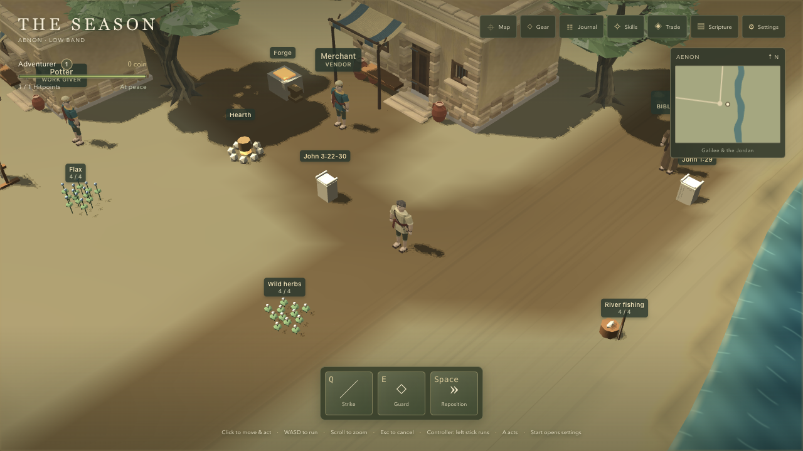 | 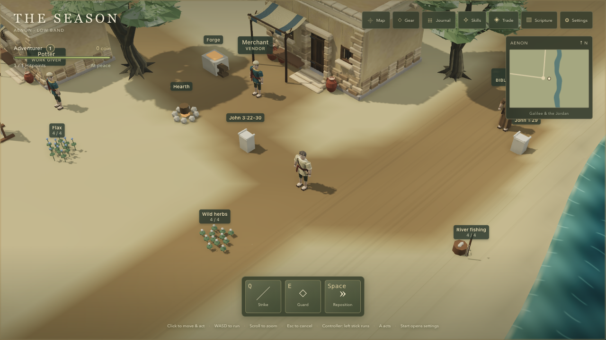 |
| aenon-near | 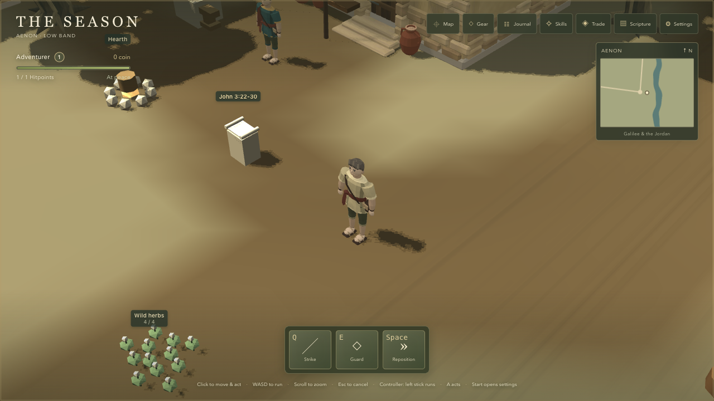 | 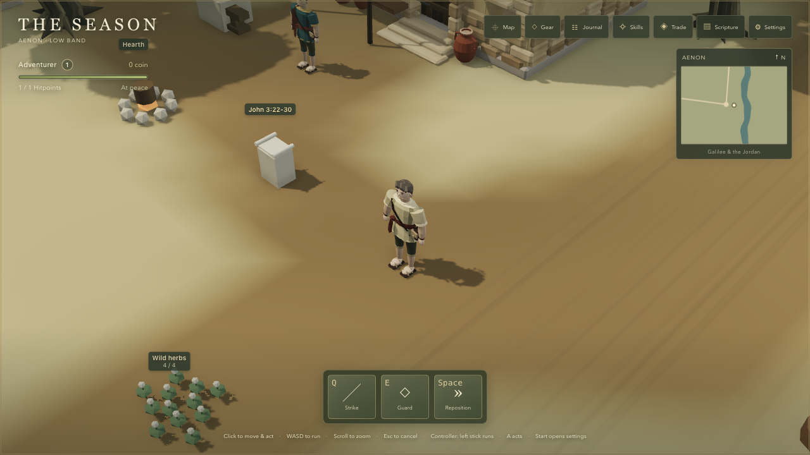 |
| aenon-far | 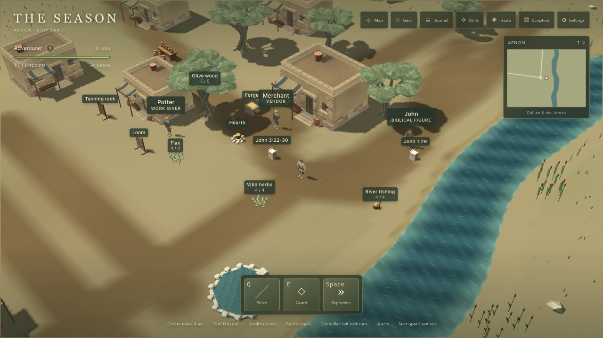 | 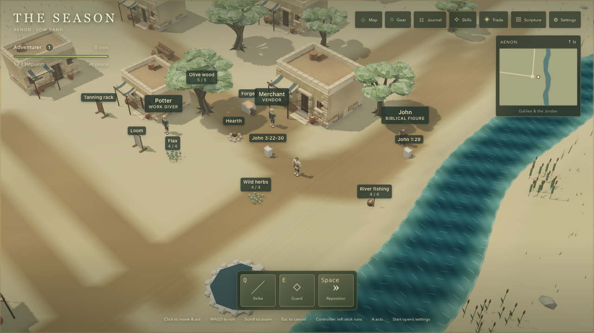 |
| aenon-riverbank | 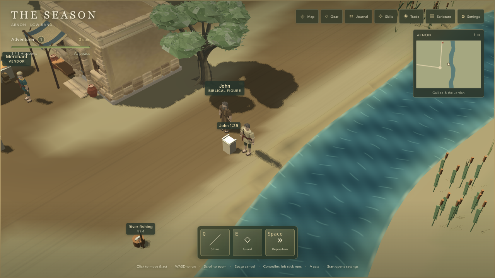 | 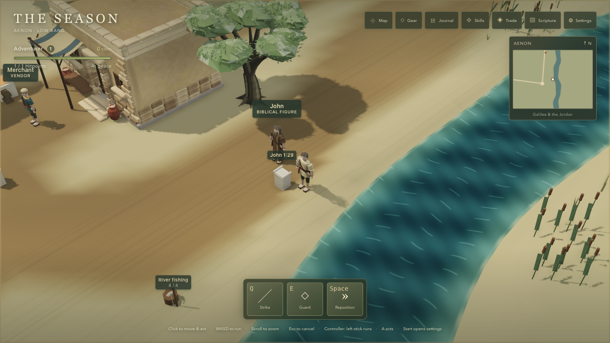 |
| jordan-bridge | 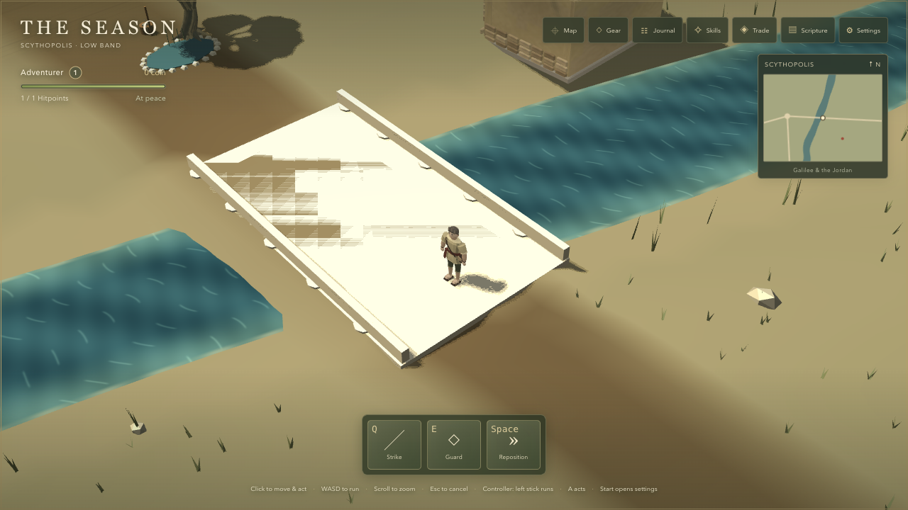 | 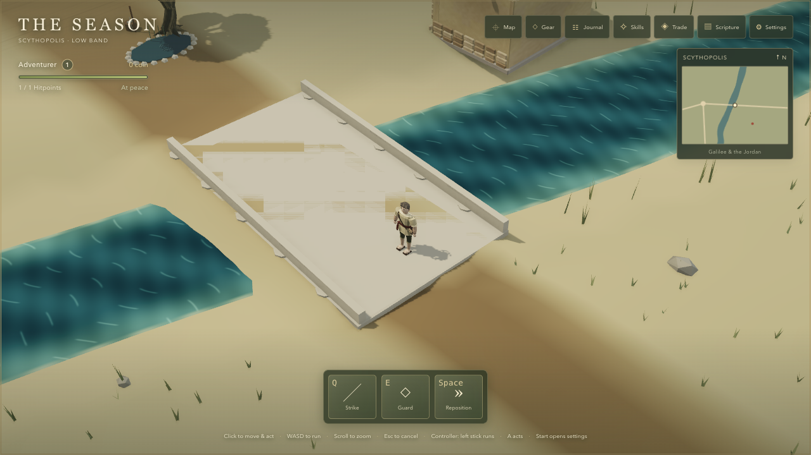 |
| scythopolis-market | 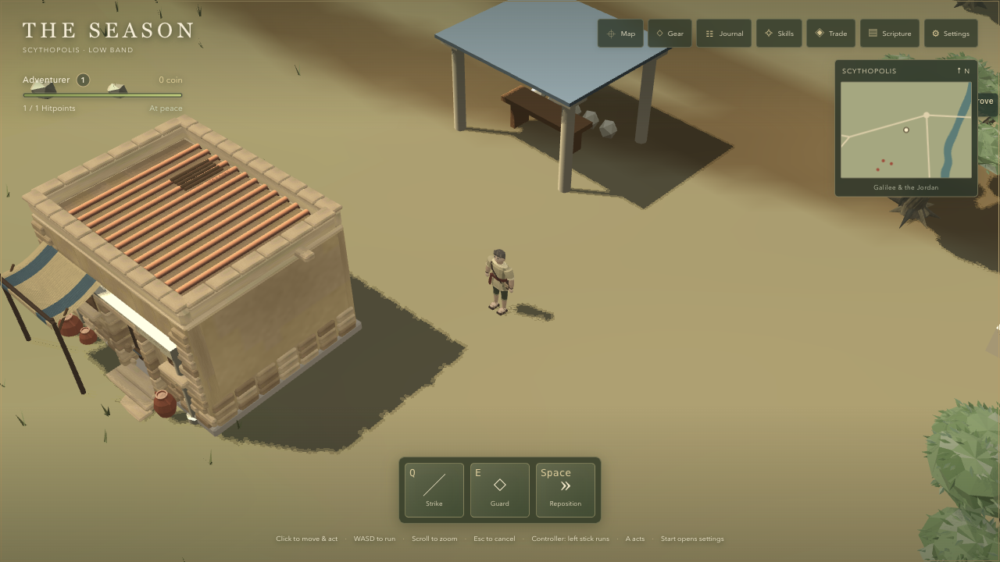 | 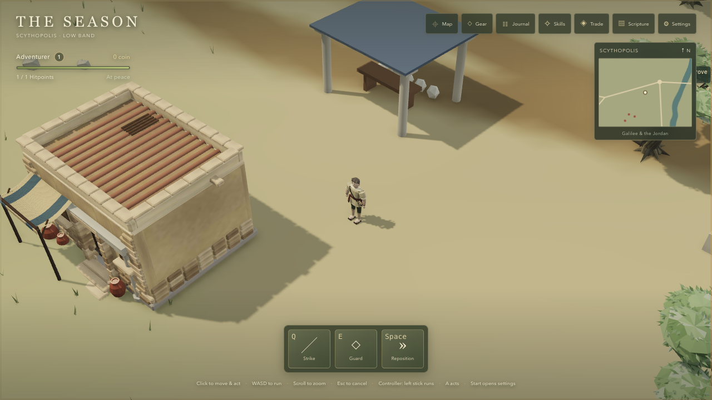 |
| sea-shore | 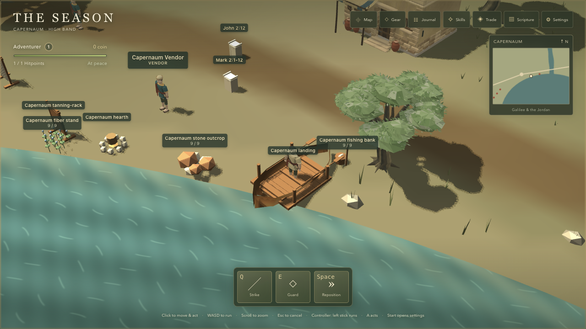 | 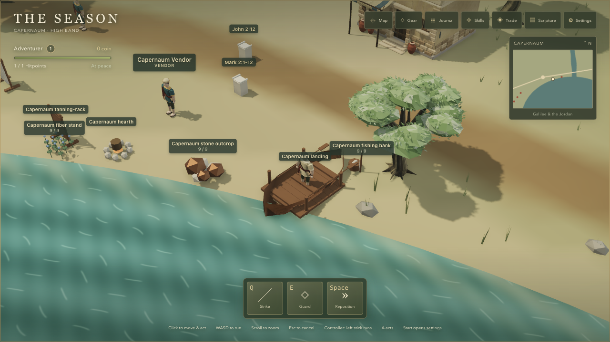 |
| fight | 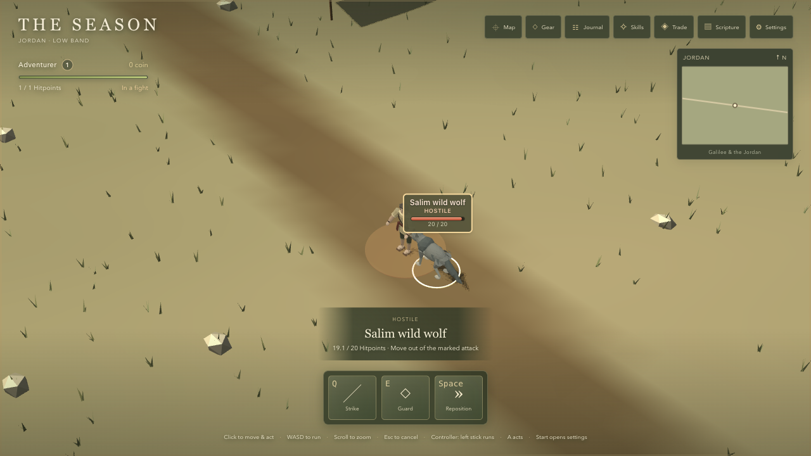 | 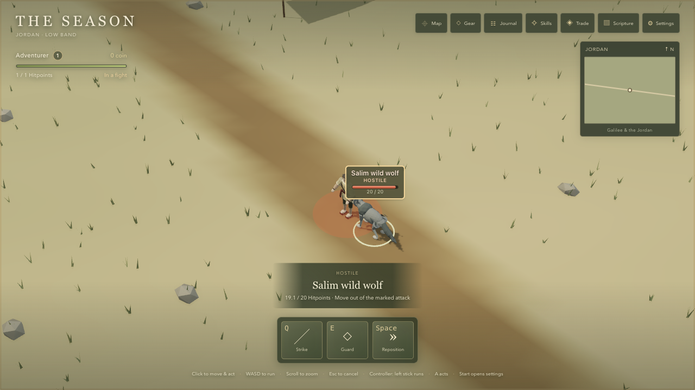 |

## Every preset

Before — all 32 captures:

| Shot | Low | Medium | High | Ultra |
| --- | --- | --- | --- | --- |
| aenon-square | [Low](before/aenon-square-low.png) | [Medium](before/aenon-square-medium.png) | [High](before/aenon-square-high.png) | [Ultra](before/aenon-square-ultra.png) |
| aenon-near | [Low](before/aenon-near-low.png) | [Medium](before/aenon-near-medium.png) | [High](before/aenon-near-high.png) | [Ultra](before/aenon-near-ultra.png) |
| aenon-far | [Low](before/aenon-far-low.png) | [Medium](before/aenon-far-medium.png) | [High](before/aenon-far-high.png) | [Ultra](before/aenon-far-ultra.png) |
| aenon-riverbank | [Low](before/aenon-riverbank-low.png) | [Medium](before/aenon-riverbank-medium.png) | [High](before/aenon-riverbank-high.png) | [Ultra](before/aenon-riverbank-ultra.png) |
| jordan-bridge | [Low](before/jordan-bridge-low.png) | [Medium](before/jordan-bridge-medium.png) | [High](before/jordan-bridge-high.png) | [Ultra](before/jordan-bridge-ultra.png) |
| scythopolis-market | [Low](before/scythopolis-market-low.png) | [Medium](before/scythopolis-market-medium.png) | [High](before/scythopolis-market-high.png) | [Ultra](before/scythopolis-market-ultra.png) |
| sea-shore | [Low](before/sea-shore-low.png) | [Medium](before/sea-shore-medium.png) | [High](before/sea-shore-high.png) | [Ultra](before/sea-shore-ultra.png) |
| fight | [Low](before/fight-low.png) | [Medium](before/fight-medium.png) | [High](before/fight-high.png) | [Ultra](before/fight-ultra.png) |

After — all 32 captures at `c38295d`:

| Shot | Low | Medium | High | Ultra |
| --- | --- | --- | --- | --- |
| aenon-square | [Low](after/aenon-square-low.png) | [Medium](after/aenon-square-medium.png) | [High](after/aenon-square-high.png) | [Ultra](after/aenon-square-ultra.png) |
| aenon-near | [Low](after/aenon-near-low.png) | [Medium](after/aenon-near-medium.png) | [High](after/aenon-near-high.png) | [Ultra](after/aenon-near-ultra.png) |
| aenon-far | [Low](after/aenon-far-low.png) | [Medium](after/aenon-far-medium.png) | [High](after/aenon-far-high.png) | [Ultra](after/aenon-far-ultra.png) |
| aenon-riverbank | [Low](after/aenon-riverbank-low.png) | [Medium](after/aenon-riverbank-medium.png) | [High](after/aenon-riverbank-high.png) | [Ultra](after/aenon-riverbank-ultra.png) |
| jordan-bridge | [Low](after/jordan-bridge-low.png) | [Medium](after/jordan-bridge-medium.png) | [High](after/jordan-bridge-high.png) | [Ultra](after/jordan-bridge-ultra.png) |
| scythopolis-market | [Low](after/scythopolis-market-low.png) | [Medium](after/scythopolis-market-medium.png) | [High](after/scythopolis-market-high.png) | [Ultra](after/scythopolis-market-ultra.png) |
| sea-shore | [Low](after/sea-shore-low.png) | [Medium](after/sea-shore-medium.png) | [High](after/sea-shore-high.png) | [Ultra](after/sea-shore-ultra.png) |
| fight | [Low](after/fight-low.png) | [Medium](after/fight-medium.png) | [High](after/fight-high.png) | [Ultra](after/fight-ultra.png) |
