# Slice 5 — Textured ground

Implements [#54](https://github.com/asvirts/aenon/issues/54) under [#41](https://github.com/asvirts/aenon/issues/41). **Final-code evidence complete; reporter visual approval pending.**

Base: `925d2e1923789bb7502c78fc444f042cc3cad51e`. Final source: `97182d109671a68f1a6a93f6b90a1bf8d8da6dbc`. The 32 before PNGs and eight before timing rows use the merged lighting base. All 32 after PNGs, repeated captures, eight after timing rows, production load and route recording use the final ground source, including the brown/ochre dirt correction for combat-cue readability. See [before shot states](before/shots.json), [after shot states](after/shots.json) and [QA summary](qa-summary.json).

## Change

Six CC0 texture sets supply colour and normal detail for seven blended ground zones: lush grass, dry golden grass, dirt, settlement stones, sand, mud and slope rock. Existing road distance, settlement geometry, water distance and slope drive the masks. Two offset texture samples, irregular blend masks and broad colour variation reduce obvious tiling. Roads retain their existing route, with textured wheel ruts and narrower worn edges. The mud-to-grass transition follows existing banks.

Low keeps colour textures and omits normal-map sampling. Medium, High and Ultra add normal detail through the existing PBR lighting, shadows and fog. Terrain heights, collision, navigation, simulation and save format are unchanged. No vegetation, water or architecture replacement is included in this slice.

## Protocol and verification

October 11, 2026. Apple MacBook Pro, M5 Pro (15 CPU / 16 GPU cores), 48 GB RAM; macOS 26.7.1; Codex in-app Chromium 155. CSS viewport 1280 × 720, DPR 1. Five seconds of visible warmup and ten seconds of completed frames per timing row, at radius 12 m and 44 m. Hidden-tab time is excluded by the harness. Low renders at 914 × 514; other presets render at 1280 × 720. First-playable transfer is a separate production measurement. Follow the [review protocol](../../../review-protocol.md).

The implementation reports **591 tests passed**, plus passing typecheck and production build on final source `97182d1`. Independent source review found no actionable issue in the ground shader, paint attributes, texture lifecycle or source provenance. All 32 final PNGs were inspected as contact sheets, and the final Low fight at native resolution. The corrected dirt colour leaves the orange warning disc distinguishable from the road; the target ring and actors remain readable in this recorded fight. These are implementation checks; the reporter supplies visual approval.

[The final bridge walk](interaction/bridge-route.webm) records 22 seconds and 70.205 m of travel, from x = 8 to x = 78.0349, after selecting Pella in the normal Map panel. Of 89 position samples, the first is idle and all remaining 88 report running. Maximum sampled distance from the existing road centerline is 1.46 × 10⁻¹³ m. The recording reaches the east bank and stops before Pella. The canvas-only VP9 recording excludes DOM panels; see [samples](interaction/bridge-route-samples.json), [route QA](interaction/bridge-route-qa.json) and [end frame](interaction/bridge-route-end.png).

Retained base limitations: the Jordan bridge has visible deck striping/seams, and some Aenon labels overlap the HUD. Architecture [#58](https://github.com/asvirts/aenon/issues/58) owns the bridge geometry. This ground slice does not claim those existing defects are fixed.

[Save isolation](storage-isolation.json) records an empty origin unchanged after all 32 shots and a review reload. It demonstrates no review writes in this run; it does not exercise preservation of a populated save. [Production readback](production-guard-after.json) reached ready, selected Medium and exposed neither `reviewShot` nor `measure`.

All 32 repeated final-source states match. Pixel comparison counts a pixel when any RGB channel differs by more than 8/255, without alignment or masks. The largest difference is **718 / 921,600 pixels (0.077908%)**, in `fight-medium.png`, inside bounding box `[609, 321, 736, 461]` (right/bottom exclusive). [Repeat-image results](repeat-image-differences-after.json) retain counts, bounds and hashes; [state results](repeatability-after.json) retain the repeated fixtures. Skeletal animation continues while the simulation is held, so exact state equality does not imply pixel identity or establish the cause of the differences.

After samples average **119.9–120.0 FPS on Low**, **104.3–112.4 on Medium**, **73.1–101.9 on High**, and **73.9–83.3 on Ultra**. The measured Low and High samples exceed their 30/60 FPS aims on this M5 Pro. Each range covers two short samples on one machine; it does not establish sustained performance, the ordinary-laptop target or a causal improvement/regression. Reporter visual acceptance remains pending.

## Assets and download

Six stylized sets by Katsukagi from 3dtextures.me are retained with the official CC0 declaration, original 1K images, download metadata and SHA-256 checksums in [art/vendor/3dtextures/ground](../../../../../art/vendor/3dtextures/ground/). [Conversion instructions](../../../../../art/vendor/3dtextures/ground/README.md) and the conversion manifest reproduce twelve 512 × 512 KTX2 maps with ten mip levels each. Colour uses ETC1S sRGB; normals use UASTC with Zstd. All twelve files are registered in [art/credits.json](../../../../../art/credits.json) and [CREDITS.md](../../../../../CREDITS.md). Their combined shipped file size is **2,234,439 bytes**.

| Code | Encoded payload | Responses | Estimated transferred MB |
| --- | ---: | ---: | ---: |
| Before `925d2e1` (runtime-equivalent `c38295d` measurement) | 7,554,960 bytes | 230 | 7.623960 |
| After `97182d1` | 9,792,246 bytes | 246 | 9.866046 |

The baseline reuses the approved lighting production measurement. `src/`, `public/`, package files, HTML entry points and Vite configuration match between the actual measured bundle `c38295d` and merged base `925d2e1`; [baseline transfer metadata](production-transfer-before.json) retains both hashes and the comparison scope. See [baseline requests](production-requests-before.jsonl) and [baseline guard](production-guard-before.json).

The [final transfer](production-transfer-after.json) includes decoder worker traffic, measured by a fresh-origin localhost logging proxy. Encoded response bodies plus an estimated 300 header bytes per response yield a **2,242,086-byte increase**, with the final **9.87 MB** below the 40 MB first-playable budget. This is a transfer estimate, not a packet capture. [Final requests](production-requests-after.jsonl) include decoder revalidation responses; the only 404 is the unrelated favicon. All runtime assets returned 200. Normal maps are loaded on Low for later preset switching even though Low does not sample them.

## Before performance

Source: [performance-before.json](performance-before.json). First-load MB comes from the separate production measurement.

| Preset | Shot / radius | Viewport | Render size | Avg FPS | p95 ms | Draw calls | Active meshes | Triangles | First-load MB |
| --- | --- | --- | --- | ---: | ---: | ---: | ---: | ---: | ---: |
| Low | aenon-near / 12 m | 1280 × 720 | 914 × 514 | 120.0 | 10.0 | 144 | 148 | 76212 | 7.62 |
| Low | aenon-far / 44 m | 1280 × 720 | 914 × 514 | 120.0 | 9.5 | 575 | 589 | 200682 | 7.62 |
| Medium | aenon-near / 12 m | 1280 × 720 | 1280 × 720 | 110.7 | 17.7 | 999 | 159 | 255388 | 7.62 |
| Medium | aenon-far / 44 m | 1280 × 720 | 1280 × 720 | 95.8 | 18.9 | 1587 | 612 | 447052 | 7.62 |
| High | aenon-near / 12 m | 1280 × 720 | 1280 × 720 | 100.5 | 18.3 | 1007 | 159 | 255388 | 7.62 |
| High | aenon-far / 44 m | 1280 × 720 | 1280 × 720 | 74.7 | 25.2 | 1595 | 612 | 447052 | 7.62 |
| Ultra | aenon-near / 12 m | 1280 × 720 | 1280 × 720 | 86.9 | 20.1 | 3533 | 159 | 776614 | 7.62 |
| Ultra | aenon-far / 44 m | 1280 × 720 | 1280 × 720 | 74.5 | 21.7 | 4556 | 612 | 1152880 | 7.62 |

## After performance

Source: [performance-after.json](performance-after.json). First-load MB comes from the separate production measurement.

| Preset | Shot / radius | Viewport | Render size | Avg FPS | p95 ms | Draw calls | Active meshes | Triangles | First-load MB |
| --- | --- | --- | --- | ---: | ---: | ---: | ---: | ---: | ---: |
| Low | aenon-near / 12 m | 1280 × 720 | 914 × 514 | 119.9 | 9.4 | 144 | 148 | 76212 | 9.87 |
| Low | aenon-far / 44 m | 1280 × 720 | 914 × 514 | 120.0 | 9.4 | 575 | 589 | 200682 | 9.87 |
| Medium | aenon-near / 12 m | 1280 × 720 | 1280 × 720 | 112.4 | 17.5 | 999 | 159 | 255388 | 9.87 |
| Medium | aenon-far / 44 m | 1280 × 720 | 1280 × 720 | 104.3 | 17.8 | 1587 | 612 | 447052 | 9.87 |
| High | aenon-near / 12 m | 1280 × 720 | 1280 × 720 | 101.9 | 18.2 | 1007 | 159 | 255388 | 9.87 |
| High | aenon-far / 44 m | 1280 × 720 | 1280 × 720 | 73.1 | 24.4 | 1595 | 612 | 447052 | 9.87 |
| Ultra | aenon-near / 12 m | 1280 × 720 | 1280 × 720 | 83.3 | 20.2 | 3533 | 159 | 776614 | 9.87 |
| Ultra | aenon-far / 44 m | 1280 × 720 | 1280 × 720 | 73.9 | 22.2 | 4556 | 612 | 1152880 | 9.87 |

## High comparisons

Before: `925d2e1`. After: `97182d1`. High is the judging preset; reporter visual approval is pending.

| Shot | Before — High | After — High |
| --- | --- | --- |
| aenon-square | 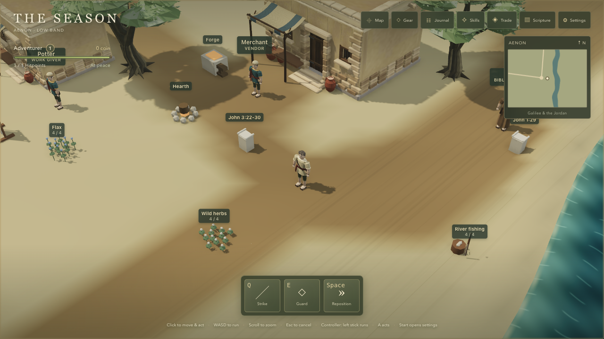 | 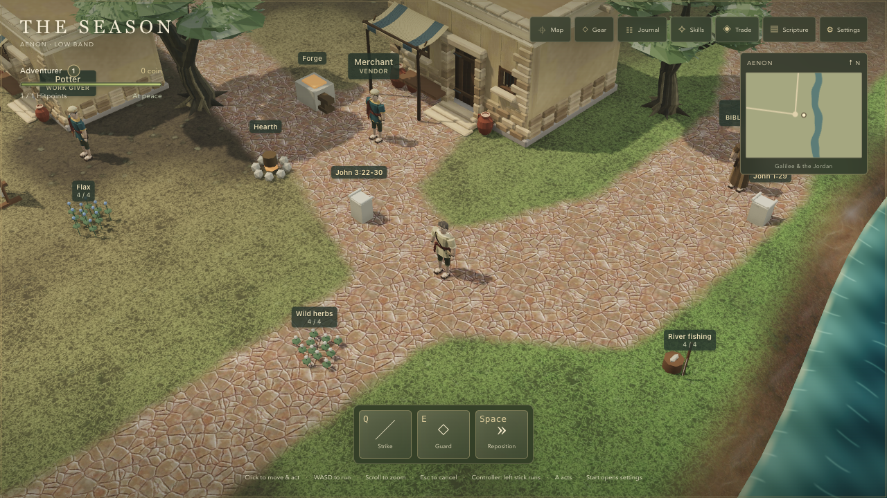 |
| aenon-near | 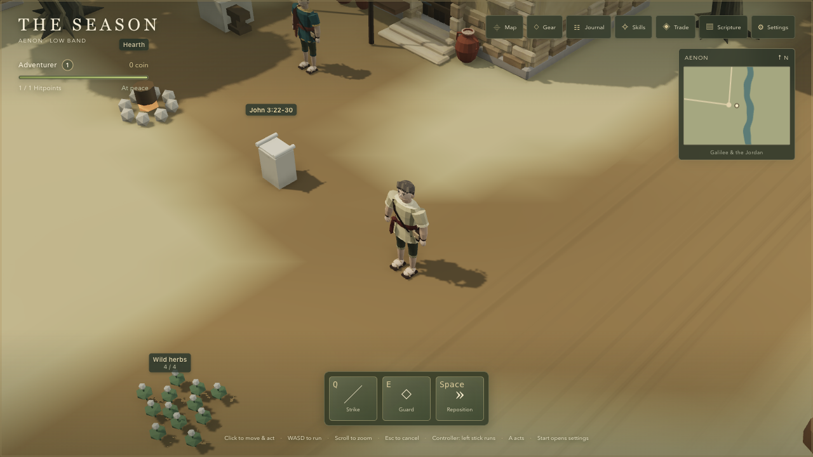 | 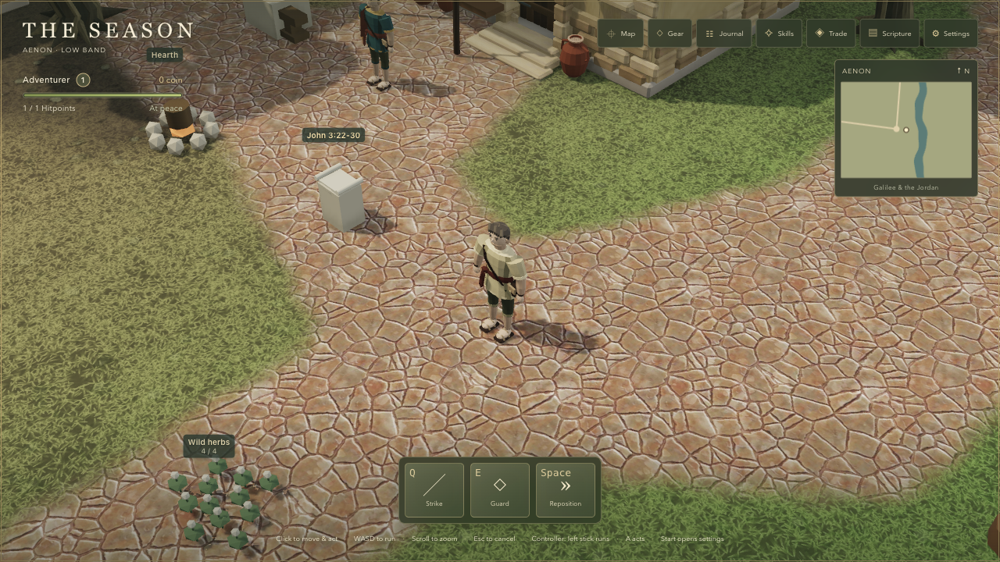 |
| aenon-far | 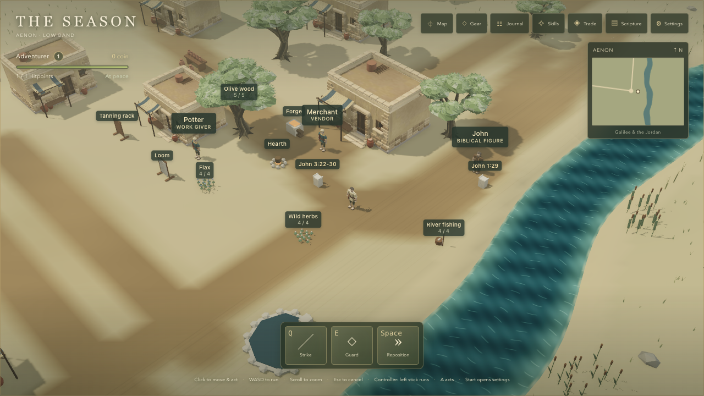 | 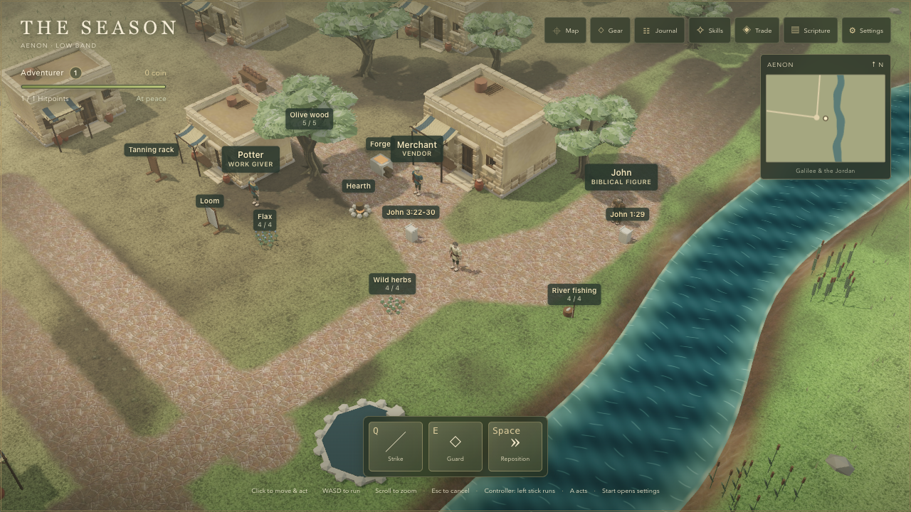 |
| aenon-riverbank | 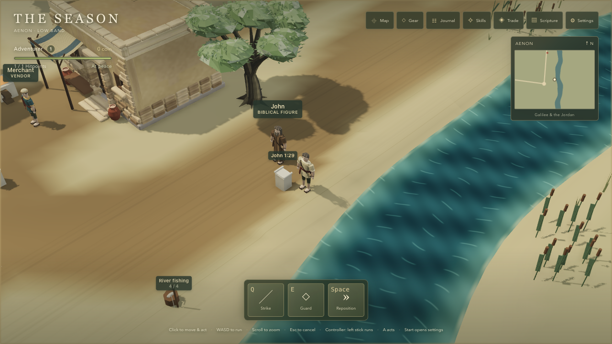 | 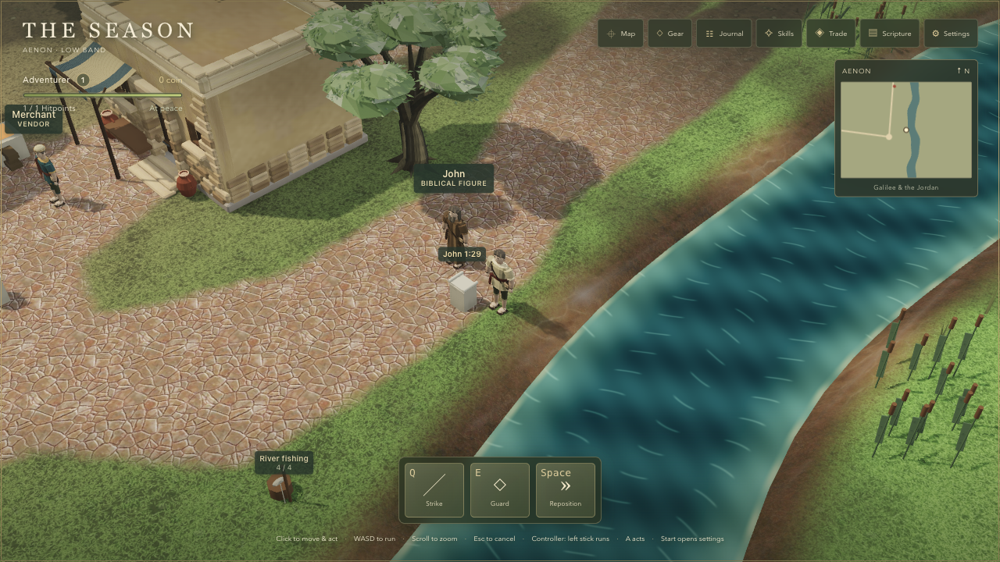 |
| jordan-bridge | 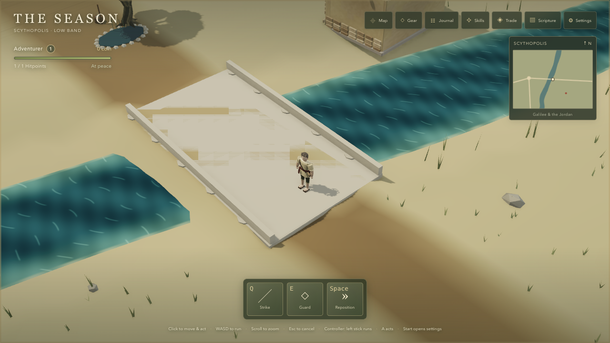 | 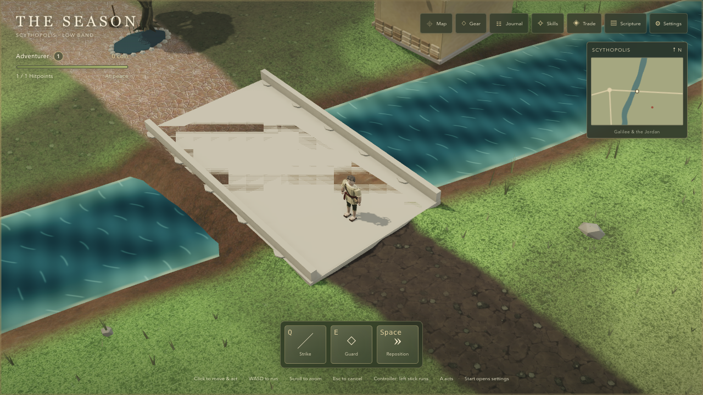 |
| scythopolis-market | 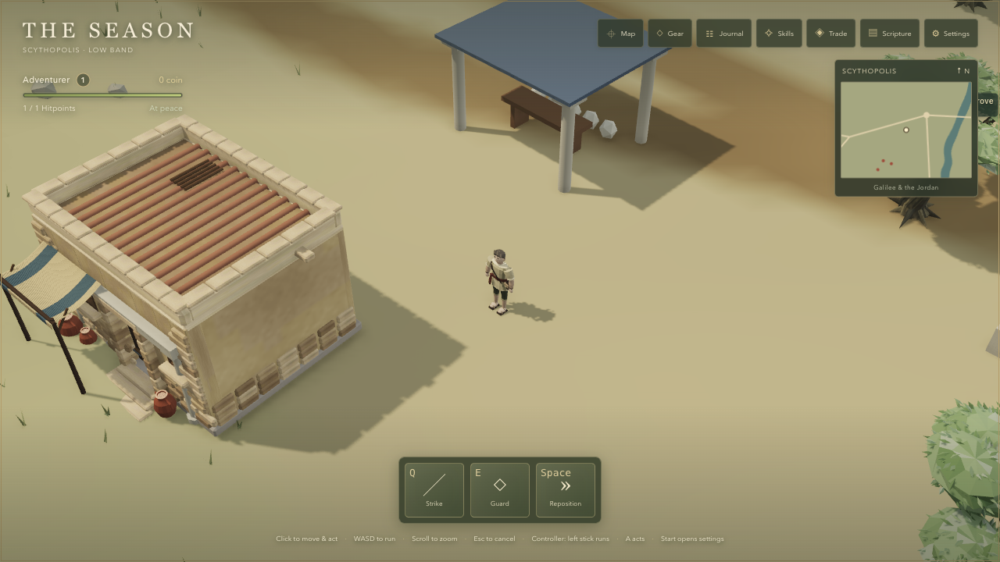 | 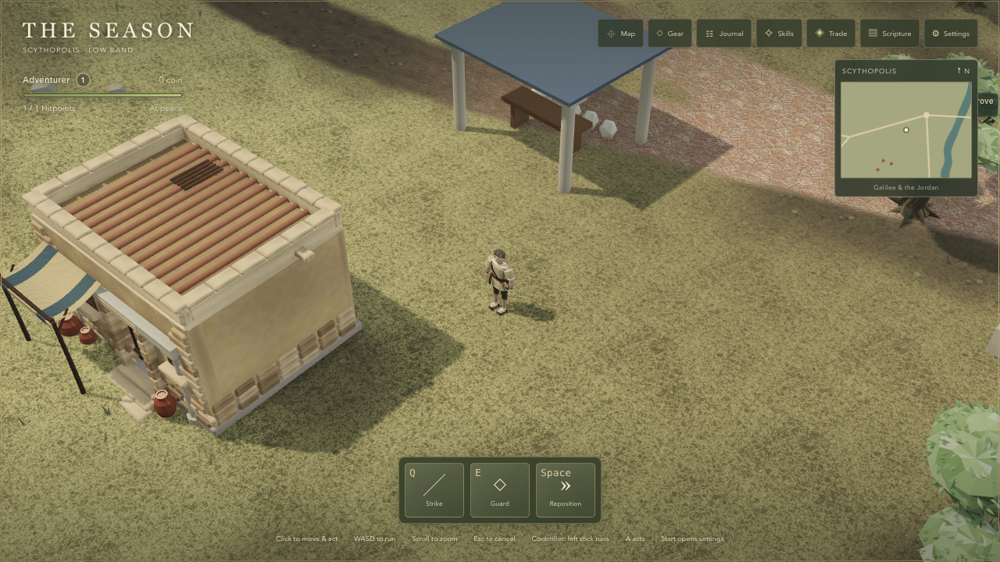 |
| sea-shore | 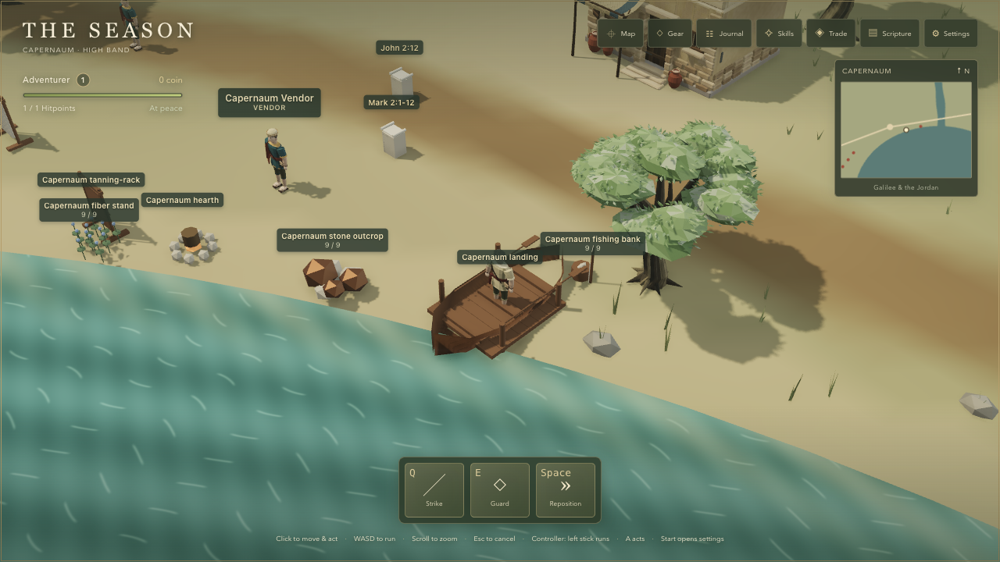 | 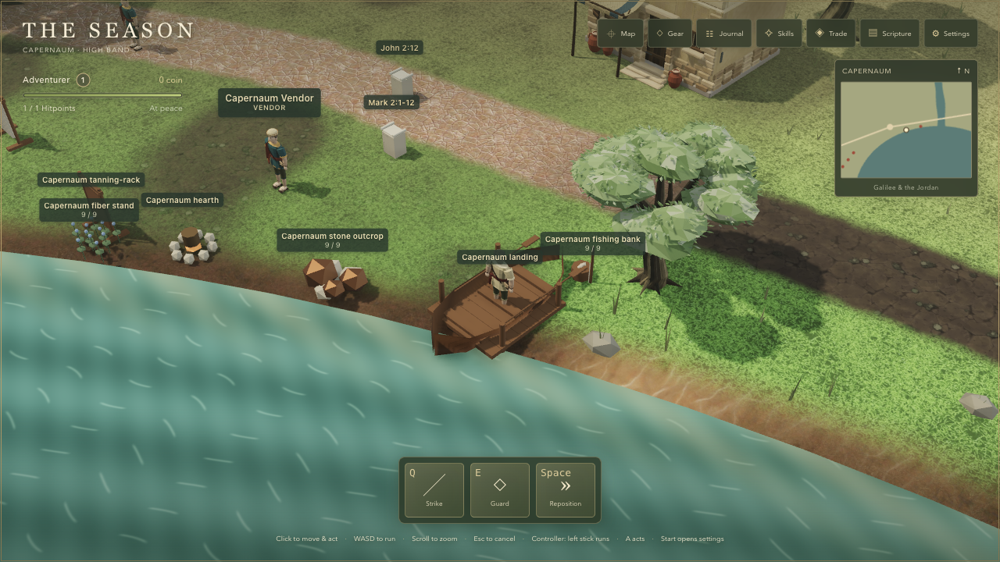 |
| fight | 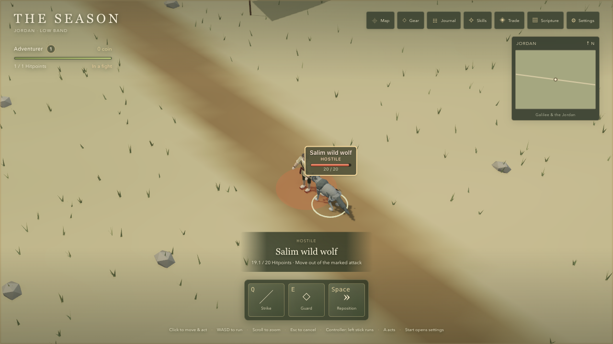 | 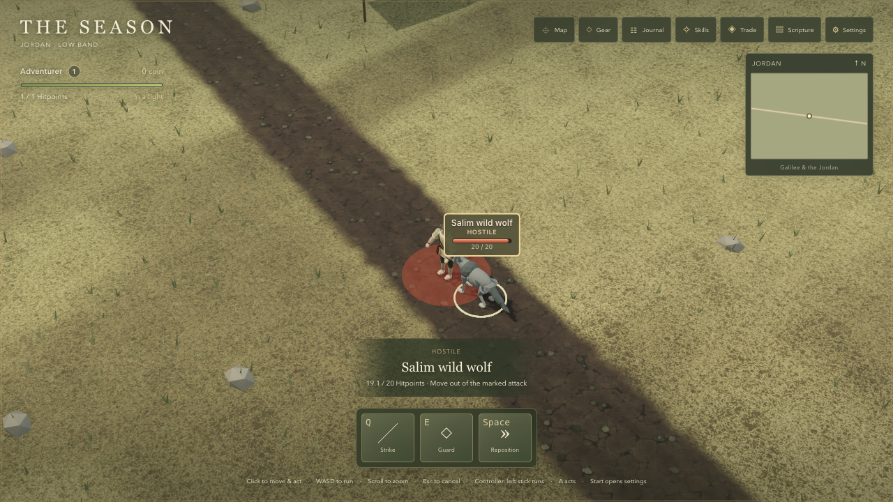 |

## Every preset

Before — all 32 captures:

| Shot | Low | Medium | High | Ultra |
| --- | --- | --- | --- | --- |
| aenon-square | [Low](before/aenon-square-low.png) | [Medium](before/aenon-square-medium.png) | [High](before/aenon-square-high.png) | [Ultra](before/aenon-square-ultra.png) |
| aenon-near | [Low](before/aenon-near-low.png) | [Medium](before/aenon-near-medium.png) | [High](before/aenon-near-high.png) | [Ultra](before/aenon-near-ultra.png) |
| aenon-far | [Low](before/aenon-far-low.png) | [Medium](before/aenon-far-medium.png) | [High](before/aenon-far-high.png) | [Ultra](before/aenon-far-ultra.png) |
| aenon-riverbank | [Low](before/aenon-riverbank-low.png) | [Medium](before/aenon-riverbank-medium.png) | [High](before/aenon-riverbank-high.png) | [Ultra](before/aenon-riverbank-ultra.png) |
| jordan-bridge | [Low](before/jordan-bridge-low.png) | [Medium](before/jordan-bridge-medium.png) | [High](before/jordan-bridge-high.png) | [Ultra](before/jordan-bridge-ultra.png) |
| scythopolis-market | [Low](before/scythopolis-market-low.png) | [Medium](before/scythopolis-market-medium.png) | [High](before/scythopolis-market-high.png) | [Ultra](before/scythopolis-market-ultra.png) |
| sea-shore | [Low](before/sea-shore-low.png) | [Medium](before/sea-shore-medium.png) | [High](before/sea-shore-high.png) | [Ultra](before/sea-shore-ultra.png) |
| fight | [Low](before/fight-low.png) | [Medium](before/fight-medium.png) | [High](before/fight-high.png) | [Ultra](before/fight-ultra.png) |

After — all 32 captures:

| Shot | Low | Medium | High | Ultra |
| --- | --- | --- | --- | --- |
| aenon-square | [Low](after/aenon-square-low.png) | [Medium](after/aenon-square-medium.png) | [High](after/aenon-square-high.png) | [Ultra](after/aenon-square-ultra.png) |
| aenon-near | [Low](after/aenon-near-low.png) | [Medium](after/aenon-near-medium.png) | [High](after/aenon-near-high.png) | [Ultra](after/aenon-near-ultra.png) |
| aenon-far | [Low](after/aenon-far-low.png) | [Medium](after/aenon-far-medium.png) | [High](after/aenon-far-high.png) | [Ultra](after/aenon-far-ultra.png) |
| aenon-riverbank | [Low](after/aenon-riverbank-low.png) | [Medium](after/aenon-riverbank-medium.png) | [High](after/aenon-riverbank-high.png) | [Ultra](after/aenon-riverbank-ultra.png) |
| jordan-bridge | [Low](after/jordan-bridge-low.png) | [Medium](after/jordan-bridge-medium.png) | [High](after/jordan-bridge-high.png) | [Ultra](after/jordan-bridge-ultra.png) |
| scythopolis-market | [Low](after/scythopolis-market-low.png) | [Medium](after/scythopolis-market-medium.png) | [High](after/scythopolis-market-high.png) | [Ultra](after/scythopolis-market-ultra.png) |
| sea-shore | [Low](after/sea-shore-low.png) | [Medium](after/sea-shore-medium.png) | [High](after/sea-shore-high.png) | [Ultra](after/sea-shore-ultra.png) |
| fight | [Low](after/fight-low.png) | [Medium](after/fight-medium.png) | [High](after/fight-high.png) | [Ultra](after/fight-ultra.png) |
