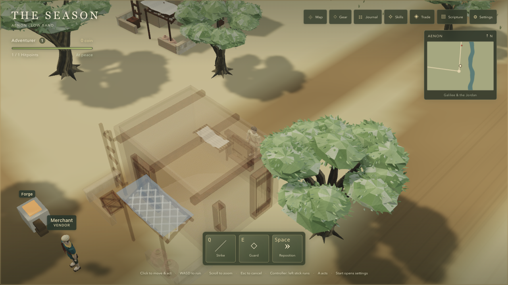
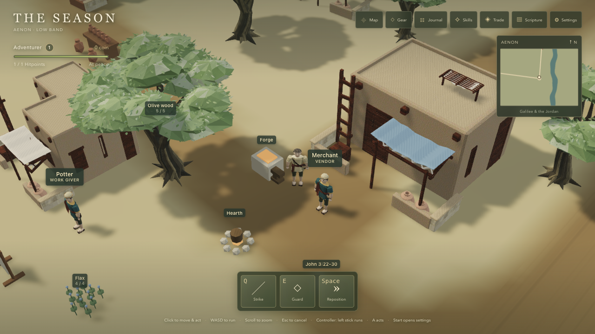

# Slice 9 — Architecture

Implements [#58](https://github.com/asvirts/aenon/issues/58) under [#41](https://github.com/asvirts/aenon/issues/41). **Implementation and recorded engineering/browser checks complete. Reporter visual approval pending.**

Base: `925d2e1923789bb7502c78fc444f042cc3cad51e`. Final implementation: `db6f9dc836433463e87ec94c6d2d849eb8f5458b`. The common approved-lighting baseline supplies the 32 before frames and eight before timing rows. [provenance.json](provenance.json) distinguishes those records, the supplemental fixture patch, and the reused runtime-equivalent production baseline. The first `f11de68` after-capture set is rejected: olives disappeared in Low, Medium and Ultra after an accidental loader change from cloning to instancing. The final source restores the baseline clone default through a shared loader and adds an actual olive-asset regression. All 40 final frames were replaced at `db6f9dc` and independently inspected; olives are visible across all four presets. See [diagnostic image](diagnostics/rejected-f11de68-tree-visibility-ultra.png) and [qa-summary.json](qa-summary.json).

## Change and preserved contracts

Six flat-roofed house assemblies replace the repeated house and primitive dressing: limestone, courtyard, mudbrick, workshop, public assembly hall, and colonnaded house. Parapets, ladders, drying racks, shade cloth, storage jars, courtyard walls and timber details distinguish them. Scythopolis and other larger towns receive dressed stone, profiled columns, public buildings and cloth-covered market porticoes. Four domestic variants remain available across the ordinary settlement footprints.

Every imported house stays within the existing asymmetric local footprint, x `[-3.3,3.3]` and z `[-2.8,3.4]`, with its front courtyard facing +Z in the host's right-handed scene. Existing house positions, scales, rotations, navigation and collision remain unchanged. Complete cloned buildings retain one occlusion group; neighboring buildings share geometry/materials while keeping independent visibility. Render meshes continue through the existing shadow registration.

Continuous bridge decks follow the existing crossing centre lines. The Jordan deck is 2.5 cm above the unchanged y=.57 walk surface; the other bridges add millimetre-scale separation where crossings overlap. Metre-scale UV repetition replaces the stretched masonry seen in the first development capture. The baseline coplanar striping belongs to the old bridge, and this slice replaces that geometry. Timber piers turn and extend from unchanged shore-side landing anchors. Boats float beside them with submerged keels and a shaped dry planked interior above water; selecting a boat still uses its original landing ID and boarding point. Traveling boats retain the journey transform.

No changes were made to simulation, content/navigation definitions, terrain heights, storage, or the save format. Supplemental DEV-only `architectureShot('salim'|'pella', preset)` fixtures preserve the canonical eight-shot list. They use Salim (−206,164) and Pella (210,−73), radius 44 m, to include the northern house rows.

## Verification

Final code passed **599 tests in 49 suites**, [typecheck](checks/typecheck.log) and [production build](checks/build.log). Retained [full test output](checks/npm-test.log) and [focused architecture/occlusion output](checks/architecture-occlusion-focused.log) belong to `db6f9dc`. The existing Vite large-chunk advisory remains. Actual imported-geometry tests cover olive clone visibility independence, house footprint and orientation, whole-house fade isolation, bridge placement and independent UV scaling, complete-hull water clearance at all five ports, dock pile depth, and dry interior ray intersections between benches. Runtime tests decode every meshopt stream using the shipped decoder and verify shared KTX2 hashes, complete mip chains, no orphan textures, and the 1 MB model budget. The full suite includes credits and unchanged navigation/route tests.

An independent source reviewer found no actionable issues in the bridge/mooring/ladder/floor/fixture corrections. The subsequent contact-sheet review caught the olive regression above; an independent source reviewer also checked the final clone-default correction and found no further issue. Independent contact-sheet inspection of all 32 corrected canonical and eight town frames confirms olives across every preset, readable bridge masonry, coherent civic and domestic variants, and a dry boat interior beside the dock. The capture operator separately verified the bridge, boat floor and Salim composition in the browser. All 32 repeated canonical fixture states match, as do 32 canonical and eight supplemental before/after states. Eight final timing rows are recorded. Production route/occlusion, review-hook isolation and the settled browser storage-isolation checks also passed; see [qa-summary.json](qa-summary.json). These checks do not establish reporter visual approval.

## Browser interactions and save isolation

The normal production game imported a fresh version-3 save through Settings, with only its initial position changed to (−6,197.5). A Merchant label click selected the ordinary interaction target. The recorded route bends west around the house via approximately (−9.77,197.47) and (−9.77,205.12), then opens the [Merchant trade dialog](interaction/merchant-opened.png). The final position is (−8.15573,205.88121). Independent analysis of all **304 samples**, including 43 moving samples, finds every sampled position and all 303 consecutive segments traversable under unchanged navigation. All observed queued route segments are also clear; the direct route through the house is blocked.

The [interaction audit](interaction/house-route-qa.json), [raw samples](interaction/house-route-samples.json), [final state](interaction/house-route-final.json) and [30.414-second route video](interaction/house-route.webm) preserve the check. The video is the 1280 × 720 canvas at 20 FPS; separate PNGs preserve DOM labels and the trade panel. The [close import fixture](interaction/house-close-import.json) contains no added coin, experience, Gear or progress. Fixture-prediction records are explicitly labeled CLI checks and are separate from observed browser evidence.

| Behind house — whole assembly fades | After route — solid again |
| --- | --- |
|  |  |

Both full-size images were independently inspected: the whole assembly fades while the Adventurer remains visible, then returns to opaque after the detour. The earlier distant fixture did not occlude the player; its [diagnostic image](interaction/route-start-distant.png) is not fade evidence. Bridge and landing appearance were inspected in the canonical frames; their alignment, traversal definitions, complete-hull water clearance and dry floor are covered by the unchanged route tests and imported-geometry checks above.

[storage-isolation.json](storage-isolation.json) records a script-free same-origin baseline, all four review preset changes and a fully settled review reload. The origin began with zero localStorage entries and remained identical. This browser check establishes that review did not create or change entries on that empty origin; populated-save protection is covered by automated storage tests. No player's save contents were retained, and the temporary script-free page was removed.

## Source and asset provenance

Retained Anker Desert Buildings FBX files come from the official CC0 asset page, with the declaration preserved alongside source hashes. Quaternius Medieval Village MegaKit contributions use the downloaded Standard archive's byte-for-byte `License_Standard.txt`, which explicitly grants CC0-1.0. That archive-specific text is the licensing basis. Plaster 002, Stylized Stone Wall 002 and Stylized Wood Planks 002 come from Katsukagi's 3dtextures.me CC0 sets; retained metadata records exact pages, public download IDs and checksums. Original assembly and modeled contributions retain the project's existing licensing treatment.

See the [intake and rebuild instructions](../../../../../art/vendor/architecture/README.md), [runtime manifest](../../../../../art/source/architecture/runtime-manifest.json), [credits register](../../../../../art/credits.json) and [generated credits](../../../../../CREDITS.md). Blender source exports are retained; the reproducible optimizer uses meshopt plus ETC1S colour and UASTC data maps with complete mip chains. Shared texture extraction preserves compressed streams and logical fallback offsets.

Exact runtime slice size is **4,113,529 bytes**: 11 GLBs totaling 947,668 bytes and 22 unique shared KTX2 files totaling 3,165,861 bytes. The largest GLB is 193,340 bytes; every model stays below 1 MB. These file bytes are separate from the 11.477292 MB estimated first-playable network transfer below.

## Capture and measurement protocol

October 11, 2026; Apple MacBook Pro M5 Pro (15 CPU / 16 GPU cores), 48 GB RAM; macOS 26.7.1; Codex in-app Chromium 155. CSS viewport 1280 × 720, DPR 1. Every canonical shot is captured in Low, Medium, High and Ultra, plus separate Salim/Pella frames on all four presets. Supplemental baseline frames use a temporary DEV fixture-only patch on the approved baseline; [the exact patch](supplemental/baseline-fixture-only.patch) is retained and does not replace canonical before metadata.

Performance uses five seconds of visible warmup and ten seconds of completed frames per row, near/far zoom on every preset. Each row is one short sample on one machine and does not establish sustained performance, ordinary-laptop results, or causality. Draw calls, active meshes and triangles are mean rendered workload. The [review protocol](../../../review-protocol.md) applies. Repeat-state equality and pixel differences are reported separately because skeletal animation can continue in held shots. [repeatability.json](repeatability.json) records semantic state comparisons, both PNG hashes and pixel statistics; [repeat-shots.json](repeat-shots.json) retains repeat metadata. All 32 repeat states match exactly, and all 40 before/after states match after documented supplemental alias normalization. No PNG pairs are byte-identical. The proportion of pixels differing by more than 8/255 in any RGB channel ranges from **0.000760% to 0.182400%**, with no alignment or masking; this is measured residual variation, not a claim of pixel identity.

## Download

The [baseline production transfer](production-transfer-before.json), [request log](production-requests-before.jsonl) and [guard record](production-guard-before.json) are copied unchanged from lighting's final production run at `c38295d`. `src/`, `public/`, `package.json` and `package-lock.json` are identical between that head and the approved architecture base `925d2e1`; the verification is recorded in [provenance.json](provenance.json). This is reused evidence, not a new production run.

| Version | Encoded payload | Responses | Header allowance | Estimated transferred MB |
| --- | ---: | ---: | ---: | ---: |
| Before, runtime-equivalent `c38295d` |7,554,960 bytes |230 |300 bytes/response |7.623960 |
| After `db6f9dc` |11,386,392 bytes |303 |300 bytes/response |11.477292 |

The final [transfer summary](production-transfer-after.json) and [frozen network log](production-network-after.jsonl) include decoder-worker traffic from a fresh localhost origin. The response-body sum and response count were independently recomputed from the log. Fifty 304 responses reuse shared textures or decoders; each affected URL also has a complete 200 response in this same run. The only failed request is the optional favicon (404). The **11.477292 MB estimate is below 40 MB**, including the 300-byte-per-response allowance. This allowance is an estimate, not a packet capture. The [production guard record](production-guard-after.json) confirms ready=true on Medium and all three DEV review entry points (`reviewShot`, `measure`, `architectureShot`) undefined.

## Performance

Before source: [performance-before.json](performance-before.json). CSS viewport is 1280 × 720 at DPR 1 throughout. First-load figures are the separate production measurements above, copied into each corresponding timing row.

| Preset | Shot / radius | Viewport | Render size | Avg FPS | p95 ms | Draw calls | Active meshes | Triangles | First-load MB |
| --- | --- | --- | --- | ---: | ---: | ---: | ---: | ---: | ---: |
| Low | aenon-near / 12 m | 1280 × 720 | 914 × 514 | 120.0 | 10.0 | 144 | 148 | 76212 | 7.623960 |
| Low | aenon-far / 44 m | 1280 × 720 | 914 × 514 | 120.0 | 9.5 | 575 | 589 | 200682 | 7.623960 |
| Medium | aenon-near / 12 m | 1280 × 720 | 1280 × 720 | 110.7 | 17.7 | 999 | 159 | 255388 | 7.623960 |
| Medium | aenon-far / 44 m | 1280 × 720 | 1280 × 720 | 95.8 | 18.9 | 1587 | 612 | 447052 | 7.623960 |
| High | aenon-near / 12 m | 1280 × 720 | 1280 × 720 | 100.5 | 18.3 | 1007 | 159 | 255388 | 7.623960 |
| High | aenon-far / 44 m | 1280 × 720 | 1280 × 720 | 74.7 | 25.2 | 1595 | 612 | 447052 | 7.623960 |
| Ultra | aenon-near / 12 m | 1280 × 720 | 1280 × 720 | 86.9 | 20.1 | 3533 | 159 | 776614 | 7.623960 |
| Ultra | aenon-far / 44 m | 1280 × 720 | 1280 × 720 | 74.5 | 21.7 | 4556 | 612 | 1152880 | 7.623960 |

After source: [performance-after.json](performance-after.json), `db6f9dc`.

| Preset | Shot / radius | Viewport | Render size | Avg FPS | p95 ms | Draw calls | Active meshes | Triangles | First-load MB |
| --- | --- | --- | --- | ---: | ---: | ---: | ---: | ---: | ---: |
| Low | aenon-near / 12 m | 1280 × 720 | 914 × 514 | 120.0 | 9.8 | 129 | 133 | 68002 | 11.477292 |
| Low | aenon-far / 44 m | 1280 × 720 | 914 × 514 | 120.0 | 9.8 | 471 | 485 | 173084 | 11.477292 |
| Medium | aenon-near / 12 m | 1280 × 720 | 1280 × 720 | 117.8 | 16.0 | 832 | 144 | 207990 | 11.477292 |
| Medium | aenon-far / 44 m | 1280 × 720 | 1280 × 720 | 115.3 | 15.7 | 1331 | 508 | 380266 | 11.477292 |
| High | aenon-near / 12 m | 1280 × 720 | 1280 × 720 | 113.8 | 15.7 | 840 | 144 | 207990 | 11.477292 |
| High | aenon-far / 44 m | 1280 × 720 | 1280 × 720 | 80.0 | 21.2 | 1339 | 508 | 380266 | 11.477292 |
| Ultra | aenon-near / 12 m | 1280 × 720 | 1280 × 720 | 91.8 | 16.3 | 2910 | 144 | 611652 | 11.477292 |
| Ultra | aenon-far / 44 m | 1280 × 720 | 1280 × 720 | 82.7 | 18.3 | 3844 | 508 | 968530 | 11.477292 |

Low exceeds 30 FPS in these two short M5 Pro samples (120.0 FPS near and far). All eight samples have lower rendered workloads than their baseline counterparts. These measurements support this machine and protocol only; ordinary-laptop performance remains unmeasured.

## Comparisons

Canonical metadata: [before states](before/shots.json) and [final after states](after/shots.json). All after frames below were captured from `db6f9dc` and independently inspected. [capture-manifest.json](capture-manifest.json) records file hashes and verified 1280 × 720 dimensions for all 80 before/after PNGs. The reporter's verdict remains pending.

| Shot | Before — High | After — High |
| --- | --- | --- |
| aenon-square | [Before](before/aenon-square-high.png) | [After](after/aenon-square-high.png) |
| aenon-near | [Before](before/aenon-near-high.png) | [After](after/aenon-near-high.png) |
| aenon-far | [Before](before/aenon-far-high.png) | [After](after/aenon-far-high.png) |
| aenon-riverbank | [Before](before/aenon-riverbank-high.png) | [After](after/aenon-riverbank-high.png) |
| jordan-bridge | [Before](before/jordan-bridge-high.png) | [After](after/jordan-bridge-high.png) |
| scythopolis-market | [Before](before/scythopolis-market-high.png) | [After](after/scythopolis-market-high.png) |
| sea-shore | [Before](before/sea-shore-high.png) | [After](after/sea-shore-high.png) |
| fight | [Before](before/fight-high.png) | [After](after/fight-high.png) |

Supplemental metadata: [Salim/Pella before states](supplemental/before/shots.json) and [final after states](supplemental/after/shots.json). All eight before states preserve the exact temporary hook alias and base source commit. Positions, zoom, quality, held simulation time and combat state match the corresponding after fixtures; only the documented hook alias differs.

| Town | Before — High | After — High |
| --- | --- | --- |
| Salim | [Before](supplemental/before/salim-high.png) | [After](supplemental/after/salim-high.png) |
| Pella | [Before](supplemental/before/pella-high.png) | [After](supplemental/after/pella-high.png) |

All presets (each cell links before / after):

| Shot | Low | Medium | High | Ultra |
| --- | --- | --- | --- | --- |
| aenon-square | [Before](before/aenon-square-low.png) / [After](after/aenon-square-low.png) | [Before](before/aenon-square-medium.png) / [After](after/aenon-square-medium.png) | [Before](before/aenon-square-high.png) / [After](after/aenon-square-high.png) | [Before](before/aenon-square-ultra.png) / [After](after/aenon-square-ultra.png) |
| aenon-near | [Before](before/aenon-near-low.png) / [After](after/aenon-near-low.png) | [Before](before/aenon-near-medium.png) / [After](after/aenon-near-medium.png) | [Before](before/aenon-near-high.png) / [After](after/aenon-near-high.png) | [Before](before/aenon-near-ultra.png) / [After](after/aenon-near-ultra.png) |
| aenon-far | [Before](before/aenon-far-low.png) / [After](after/aenon-far-low.png) | [Before](before/aenon-far-medium.png) / [After](after/aenon-far-medium.png) | [Before](before/aenon-far-high.png) / [After](after/aenon-far-high.png) | [Before](before/aenon-far-ultra.png) / [After](after/aenon-far-ultra.png) |
| aenon-riverbank | [Before](before/aenon-riverbank-low.png) / [After](after/aenon-riverbank-low.png) | [Before](before/aenon-riverbank-medium.png) / [After](after/aenon-riverbank-medium.png) | [Before](before/aenon-riverbank-high.png) / [After](after/aenon-riverbank-high.png) | [Before](before/aenon-riverbank-ultra.png) / [After](after/aenon-riverbank-ultra.png) |
| jordan-bridge | [Before](before/jordan-bridge-low.png) / [After](after/jordan-bridge-low.png) | [Before](before/jordan-bridge-medium.png) / [After](after/jordan-bridge-medium.png) | [Before](before/jordan-bridge-high.png) / [After](after/jordan-bridge-high.png) | [Before](before/jordan-bridge-ultra.png) / [After](after/jordan-bridge-ultra.png) |
| scythopolis-market | [Before](before/scythopolis-market-low.png) / [After](after/scythopolis-market-low.png) | [Before](before/scythopolis-market-medium.png) / [After](after/scythopolis-market-medium.png) | [Before](before/scythopolis-market-high.png) / [After](after/scythopolis-market-high.png) | [Before](before/scythopolis-market-ultra.png) / [After](after/scythopolis-market-ultra.png) |
| sea-shore | [Before](before/sea-shore-low.png) / [After](after/sea-shore-low.png) | [Before](before/sea-shore-medium.png) / [After](after/sea-shore-medium.png) | [Before](before/sea-shore-high.png) / [After](after/sea-shore-high.png) | [Before](before/sea-shore-ultra.png) / [After](after/sea-shore-ultra.png) |
| fight | [Before](before/fight-low.png) / [After](after/fight-low.png) | [Before](before/fight-medium.png) / [After](after/fight-medium.png) | [Before](before/fight-high.png) / [After](after/fight-high.png) | [Before](before/fight-ultra.png) / [After](after/fight-ultra.png) |
| salim | [Before](supplemental/before/salim-low.png) / [After](supplemental/after/salim-low.png) | [Before](supplemental/before/salim-medium.png) / [After](supplemental/after/salim-medium.png) | [Before](supplemental/before/salim-high.png) / [After](supplemental/after/salim-high.png) | [Before](supplemental/before/salim-ultra.png) / [After](supplemental/after/salim-ultra.png) |
| pella | [Before](supplemental/before/pella-low.png) / [After](supplemental/after/pella-low.png) | [Before](supplemental/before/pella-medium.png) / [After](supplemental/after/pella-medium.png) | [Before](supplemental/before/pella-high.png) / [After](supplemental/after/pella-high.png) | [Before](supplemental/before/pella-ultra.png) / [After](supplemental/after/pella-ultra.png) |
